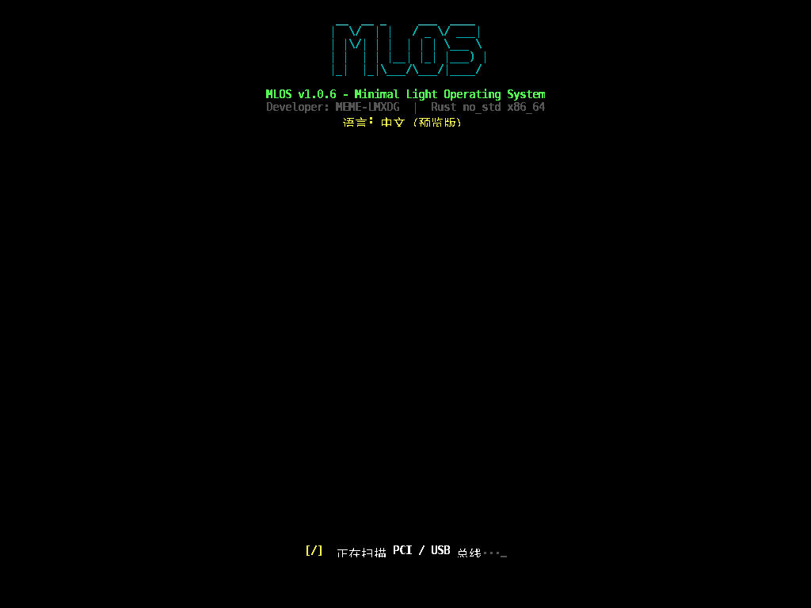
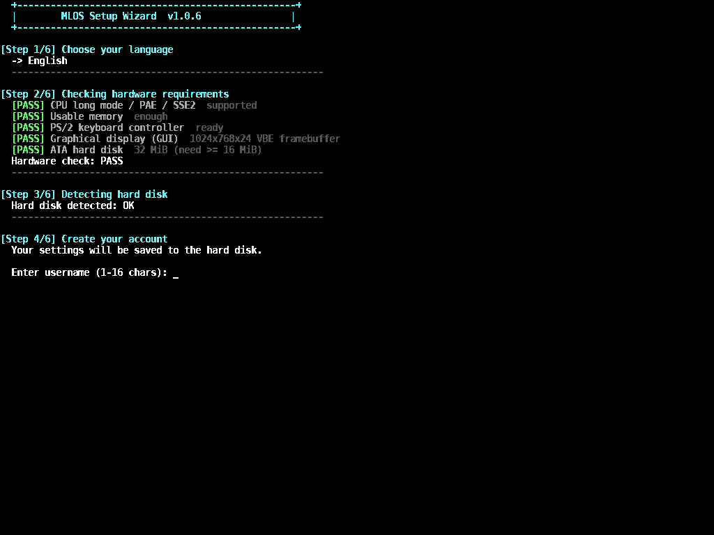
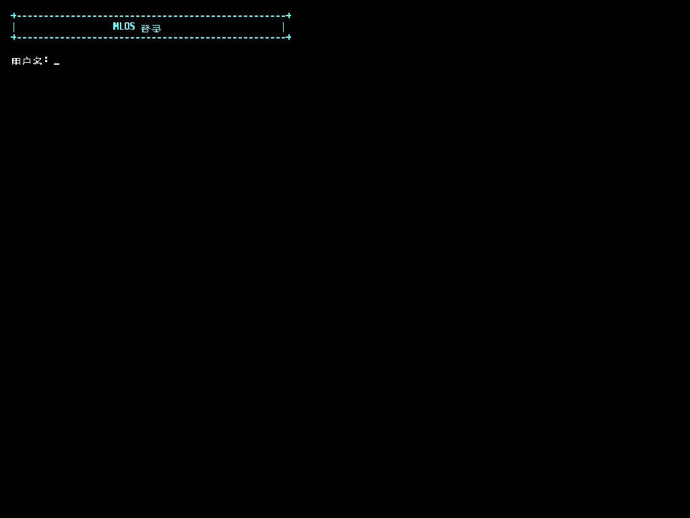
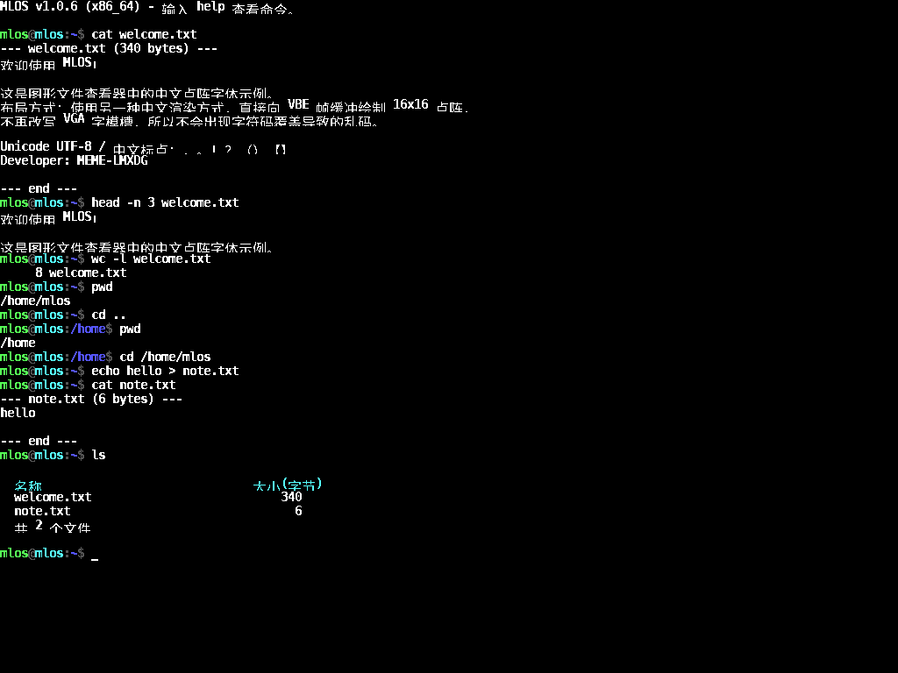
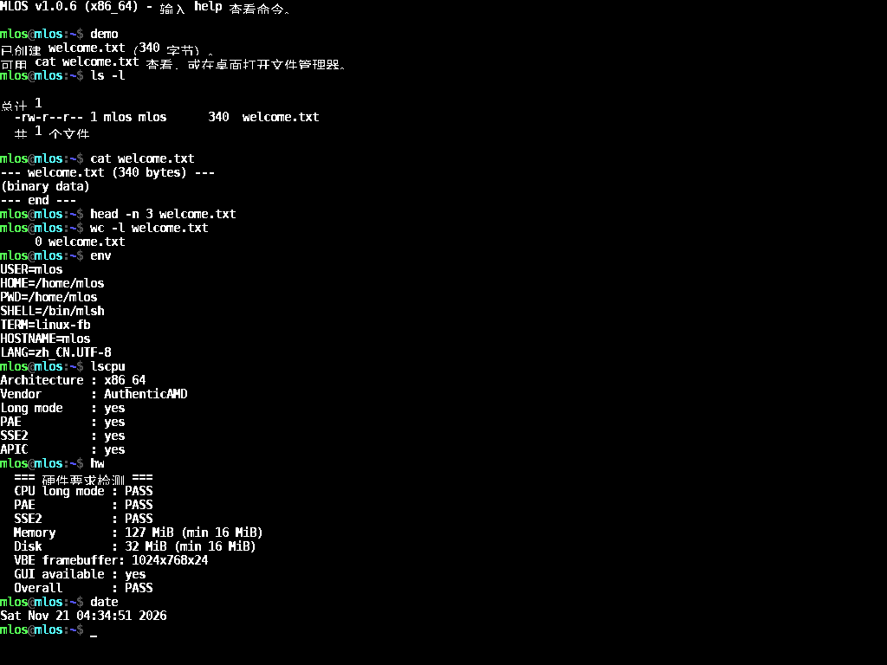
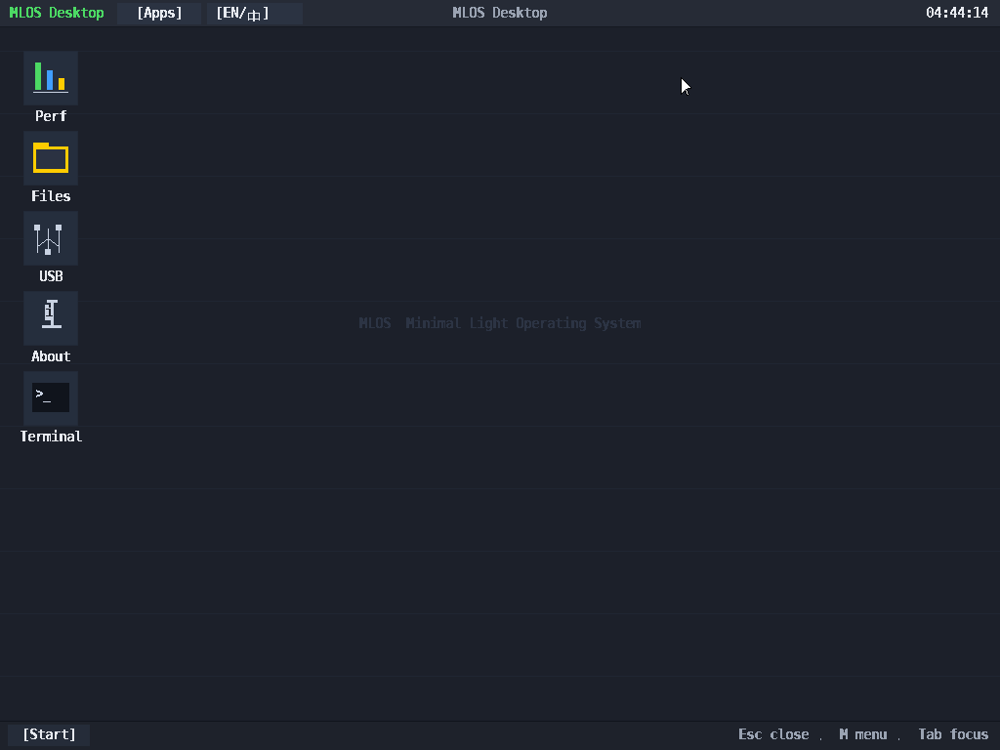
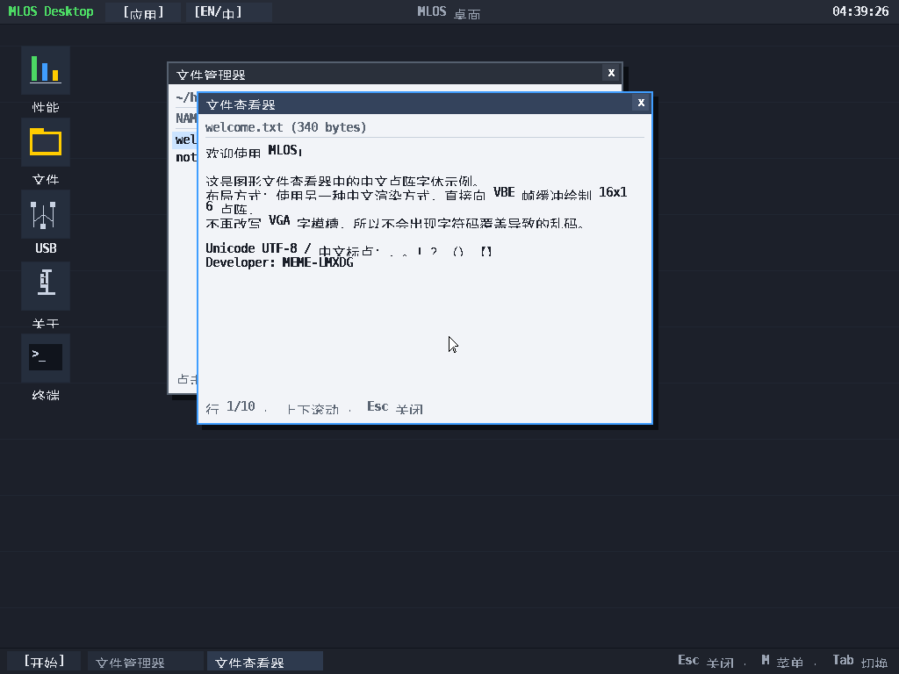
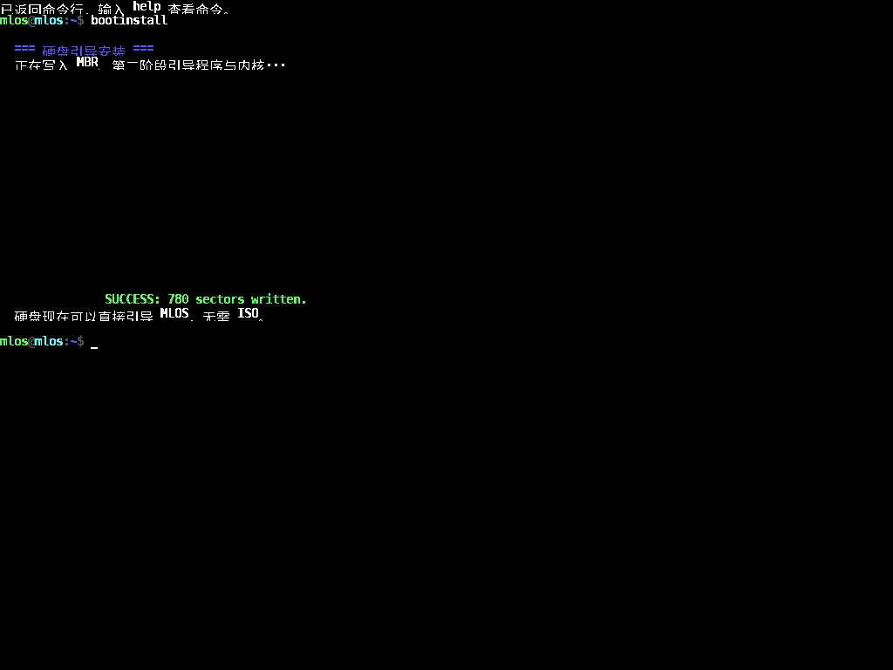

# MLOS

English | [简体中文](README.md)

**MLOS** (Minimal Light Operating System) is a small 64-bit hobby operating system written from scratch in Rust. Version **v1.0.6** renders a graphical console and desktop directly into a VBE linear framebuffer using built-in 8×16 ASCII and 16×16 CJK bitmap fonts. The ISO is self-contained (no GRUB or xorriso required) and can also install itself to an ATA disk for ISO-free boot.

- **Developer**: MEME-LMXDG
- **Language**: Rust (`no_std` / `no_main`, x86_64)
- **Repository**: <https://github.com/lmxdg/MLOS>

---

## Highlights in this version

- **GUI display fixed** — attributes were packed with reversed nibbles, and window text was drawn through the VGA text console. The desktop is now a pixel-level renderer.
- **CJK garbling fixed with a new rendering path** — 16×16 glyphs are drawn straight into the framebuffer instead of being squeezed into VGA font slots. The 64-glyph slot limit and cross-screen overwrite are gone.
- **Arrow mouse cursor** — 12×19 pixel arrow with a black outline; only the cursor region is saved/restored while moving.
- **Hardware requirements in setup** — CPU long mode/PAE/SSE2, usable RAM, ATA disk size, PS/2 controller, VBE framebuffer. Installation is refused when critical checks fail.
- **More Linux-like shell** — history (Up/Down), Tab completion, Ctrl+C/L/U, `cd` path normalisation, `cd -`, `cp/mv/find/stat/wc/head/tail/tree`, `echo >` redirection, `passwd`, `lscpu/lspci/dmesg/hw`, and more.
- **MiniFS read byte-order bug fixed** — `cat/head/wc/grep` previously returned binary data.
- **Boot/init order fixed** — display initialises before the splash; the low 4 GiB are identity-mapped so the VBE framebuffer near `0xFD000000` is writable.
- **Mouse init fixed** — correct 8042 config-byte handling, ACK handling, and AUX-only reads so keyboard bytes are not consumed.
- **Disk installer fixed** — 32 KiB stage2 loaded at `0x7E00` (no self-overwrite); only loadable segments are dumped, and the kernel clears BSS at boot.

---

## Hardware requirements

| Item | Minimum | Notes |
|------|---------|-------|
| CPU | x86_64 with PAE + SSE2 | required for long mode |
| RAM | **16 MiB** usable | 1024×768×24 framebuffer is about 2.25 MiB |
| Disk | **16 MiB** ATA/IDE | config, MiniFS and disk boot image |
| Display | VBE 2.0 linear framebuffer ≥ 800×600 | VGA text fallback works, but GUI is unavailable |
| Input | PS/2 keyboard / mouse | mouse optional |
| Firmware | **BIOS / CSM (legacy boot)** | pure UEFI is not supported yet |

The second setup step shows `[PASS]/[FAIL]` for every item and halts on critical failures.

---

## First boot (6-step wizard)

1. **Language** — English / Chinese
2. **Hardware check** — CPU, RAM, PS/2, VBE, ATA capacity
3. **Disk detection** — Primary Master ATA disk
4. **Account** — username + password (FNV-1a hash stored on disk)
5. **Install** — writes stage2 + kernel image to disk
6. **Done** — enters the shell; `bootinstall` can reinstall the disk bootloader later

Later boots require login. `exit`/`logout` signs out, `passwd` changes the password, `setup` re-runs the wizard.

---

## Display and CJK rendering

- The bootloader sets a VBE linear mode (prefers 1024×768×32; 24 bpp supported) and emits a Multiboot2 framebuffer tag
- The kernel identity-maps the low 4 GiB with 2 MiB pages, making the framebuffer directly writable
- Two embedded bitmap fonts:
  - `src/ascii_font_data.rs`: DejaVu Sans Mono Bold 8×16
  - `src/zhfont_data.rs`: Noto Sans CJK SC 16×16 (each glyph split into two 8×16 halves)
- UTF-8 is decoded directly; **no VGA font slots are used**, so a full screen of Chinese cannot corrupt itself
- Without VBE, the console falls back to VGA text mode (ROM ASCII + dynamic font RAM at `0xA0000`, limited to 64 distinct CJK glyphs per screen)

Regenerate fonts after changing UI text:

```bash
python3 tools/gen_ascii_font.py
python3 tools/gen_zhfont.py
```

---

## Desktop

Run `gui`:

- Top panel: logo, `[Apps]`, `[EN/中]` language switch, real-time clock
- Desktop icons: Performance, Files, USB, About, Terminal (back to shell)
- Windows: draggable title bar, focus raising, close button; taskbar buttons
- File Manager: click a row or press Enter to open the viewer; `D` deletes
- File Viewer: CJK-aware wrapping and scrolling
- Arrow pointer with black outline
- Keys: `Esc` close/exit, `Tab` focus, `M` menu, `L` language, arrows/Enter

---

## Shell

Prompt: `user@mlos:~$`

```
help man clear echo history exit logout reboot halt passwd
pwd cd ls ll la cat write touch rm mkdir grep head tail wc cp mv find stat tree
version uname about whoami who id hostname date uptime env
mem free df ps top perf disk usb resolution lscpu lspci lsusb dmesg hw
lang color banner setup bootinstall update gui demo
games bomb guess rps tools calc base prime hash rand ascii
```

Editing: Up/Down history, Tab completion, Ctrl+C cancel, Ctrl+L clear, Ctrl+U kill line, `echo text > file` / `>>`, `demo` creates a Chinese sample file.

---

## Run in QEMU

> The ISO boots via BIOS El Torito. Enable BIOS/CSM, not pure UEFI.

```bash
truncate -s 32M mlos-disk.img
qemu-system-x86_64 -cdrom MLOS.iso -m 128M -boot d -net none -vga std \
  -drive file=mlos-disk.img,format=raw,if=ide,index=0,media=disk
```

After installation, boot from the disk:

```bash
qemu-system-x86_64 -m 128M -boot c -net none -vga std \
  -drive file=mlos-disk.img,format=raw,if=ide,index=0,media=disk
```

---

## Build from source

Requirements: Rust stable with `rust-src`, NASM, Python 3 + `pycdlib`, optional QEMU.

```bash
make boot     # assemble MBR, stage2 and ISO boot image
make kernel   # cross-build the kernel
make iso      # build MLOS.iso (no GRUB required)
make run      # boot ISO + 32 MiB disk in QEMU
```

The repo keeps a `grub.cfg` and a Multiboot2 framebuffer request tag for optional GRUB boot, but GRUB is not required.

---

## Disk layout

| LBA | Content |
|-----|---------|
| 0 | MBR (stage 1) |
| 1 | User config (`MLOS` magic, username, FNV-1a hash, language, checksum) |
| 3 | Remote version info (`UPDT`) |
| 4 | MiniFS directory (`MFSD`, 12 entries) |
| 5+ | MiniFS file data, 8 sectors (4 KiB) per slot |
| 2048..2111 | stage2 (32 KiB) |
| 4096 | Kernel header (`MLBX`, sectors, entry offset) |
| 4097+ | Kernel flat image (loadable segments only; BSS cleared at boot) |

---

## Screenshots

| | |
|---|---|
| Splash |  |
| Setup wizard - hardware check (Chinese) |  |
| Setup wizard - hardware check (English) |  |
| Hardware failure blocks installation |  |
| Login (Chinese) |  |
| Disk boot - login (English) |  |
| Shell (Chinese) |  |
| Shell commands (English) |  |
| Desktop (English) |  |
| Apps menu (Chinese) |  |
| File Manager (Chinese) |  |
| File Manager (English) |  |
| File Viewer (Chinese) |  |
| Performance Monitor (Chinese) |  |
| Window dragging |  |
| Disk boot install success |  |

## Known limitations

- BIOS/CSM only; pure UEFI needs GOP framebuffer support
- No Chinese input method (the shell accepts ASCII input); Chinese display and file rendering work
- MiniFS is flat; directories exist only as logical prompt paths
- No preemptive scheduler, network stack or file permissions; this is a teaching/demo kernel

## License

MIT