# MLOS

[简体中文](README.md) | English

**MLOS** (Minimal Light Operating System) is a small 64-bit operating system written from scratch in Rust. It ships as a ~5 MB bootable ISO, boots with GRUB 2 (Multiboot2) on BIOS systems, and includes an interactive shell, a performance monitor, a file browser, a setup wizard with password login, hard-disk persistence, games and tools.

- **Developer**: MEME-LMXDG
- **Language**: Rust (`no_std` bare-metal kernel, x86_64)
- **Repository**: <https://github.com/lmxdg/MLOS>
- **Downloads**: <https://github.com/lmxdg/MLOS/releases>

---

## Features

### Core system
- 64-bit bare-metal kernel written in pure Rust (`no_std`, `no_main`)
- Multiboot2 boot header + GRUB 2, 32-bit protected mode → 64-bit long mode trampoline
- VGA text mode display (80×25, CP437) with hardware cursor
- PS/2 keyboard driver with full US layout (shift, backspace, enter)
- Usable-memory detection from the Multiboot2 memory map

### Installation & login (redesigned in v1.0.6)
The first boot runs a **5-step setup wizard**:

1. **Language**: English or Chinese (preview)
2. **Disk detection**: verify the ATA hard disk is present
3. **Create account**: choose username and password (FNV-1a hash on disk, never plain text)
4. **Install system**: write bootloader and kernel, with a **spinning** progress animation
5. **Done**: continue directly to the login screen

Every later boot requires login. The `setup` command re-runs the wizard, and `exit` logs out and returns to login.

### Chinese (Preview) support (new in v1.0.6)
- Run `lang zh` or pick Chinese in step 1 of the wizard to switch the interface language. The preference is saved to disk and applied automatically on the next boot.
- Implementation: VGA character-generator font reprogramming. Each 16x16 Han glyph is split into two 8x16 half-glyphs placed outside the ASCII range; ASCII glyphs remain untouched.
- The font data is generated from Noto Sans CJK SC by `tools/gen_zhfont.py` and covers the ~350 Han characters used in system strings.
- The language-switching framework, bilingual strings, font data and rendering pipeline are complete: the English UI works everywhere; the Chinese UI renders Han glyphs on VGA adapters that support font reprogramming.
- **Preview limits**:
  - Only 64 glyph slots exist; if more distinct characters appear on one screen, earlier slots are reused. Characters outside the bundled font render as `?`.
  - Some virtual VGA adapters (e.g. QEMU std / Cirrus emulation) lock character codes `0x80-0xFF` to the ROM font, so custom glyphs cannot be loaded into that range — on those hosts Chinese may appear as CP437 characters. **Real VGA hardware and standard VGA implementations are unaffected.** Use `lang en` to switch back if this occurs.
  - Experimental - feedback welcome.

### Hard-disk persistence
- ATA PIO (LBA28) driver for the Primary Master disk
- User configuration written to disk sector LBA 1 with magic + checksum
- MiniFS file store for user files

### Disk self-boot installation (no ISO needed after install)
- When the setup wizard finishes, MLOS writes the **complete system to the hard disk**:
  an MBR boot sector, a custom Stage-2 bootloader (builds the Multiboot2 info) and the kernel image
- After installation the machine boots MLOS **directly from the hard disk - the ISO is no longer needed**
  (`bootinstall` re-installs / repairs at any time)
- Custom two-stage bootloader: MBR (EDD reads) -> Stage 2 (loads kernel, e820 map, protected mode trampoline)

### USB compatibility (USB 1.0 - 3.2)
- PCI bus enumeration detects every USB host-controller class:
  **UHCI / OHCI** (USB 1.0 / 1.1), **EHCI** (USB 2.0), **xHCI** (USB 3.0 / 3.1 / 3.2)
- The `usb` command lists detected controllers (type, PCI location, speed class) and compatibility info

### Adaptive resolution
- Display metrics are auto-detected at boot: firmware framebuffer (Multiboot2) + VGA CRTC register probing
  for the real console geometry
- The `resolution` command reports adapter capability and the active console mode; GUI layout follows
  the detected display size

### Performance monitor (`perf`)
- **CPU**: vendor string via CPUID, TSC frequency calibrated against the PIT, live TSC cycle count
- **Memory**: total usable, kernel image footprint, estimated free memory and usage %
- **Disk**: capacity from ATA IDENTIFY, sectors used by MLOS, free space

### Linux-like shell (expanded in v1.0.6)
- `user@mlos:~$` style prompt with a logical working directory (`pwd`, `cd`, `cd ..`, `cd ~`)
- Linux-style commands and flags: `ls -l`, `cat -n`, `uname -a`, `grep`, `history`, `man`, `whoami`, `who`, `hostname`, `uptime`, `free`, `df`, `ps`, `top`, `mkdir` / `touch`, `exit` / `logout`
- `help` lists all commands by category; `man <command>` shows a short manual; unknown commands give a clean error
- `exit` logs out back to the login screen without a reboot

### File browser (`ls` / `cat` / `write` / `rm`)
- MiniFS: a simple file store laid out on raw disk sectors (directory sector at LBA 4, 12 file slots × 4 KB each)
- Create, list, read and delete text files directly from the shell

### Online update check (`update`)
- Compares the local version with the latest GitHub release
- MLOS has no network stack by design; the bundled host script `tools/check_update.sh` fetches the newest release tag from GitHub and writes it into disk sector LBA 3, then `update` reports: *up to date*, *new version available* (+ download URL), or *no info*

### Desktop GUI (`gui`, redesigned in v1.0.6)
- Linux-style text desktop: top panel + desktop icons + 2x2 tiled windows + bottom taskbar
- **PS/2 mouse support**: click `[Apps]` / `[Start]` to open the menu, click icons to launch programs, click a title bar to focus a window, click `[X]` to close it, click a file row to open the viewer
- Keyboard still works: `M` menu, arrows navigate, `Enter` opens, `Tab` switches focus, `Esc` closes / exits
- The old "experimental feature" confirmation is gone: `gui` or `gui on` starts the desktop immediately; the language button and menu item switch English / Chinese in place

### Games
- Number Bomb, Guess Number, Rock-Paper-Scissors

### Tools
- Calculator, base conversion, prime check, FNV-1a text hash, random numbers, ASCII table

---

## System Screenshots

| | |
|---|---|
| Shell & banner |  |
| Help | 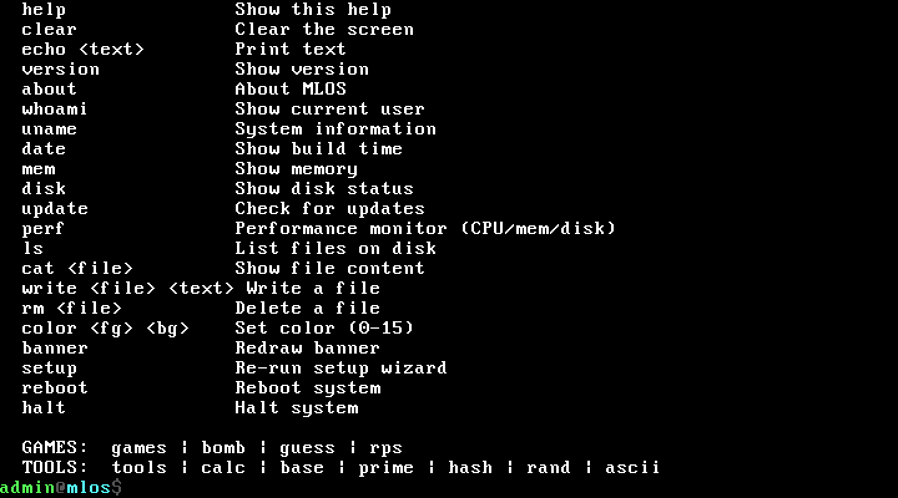 |
| About | 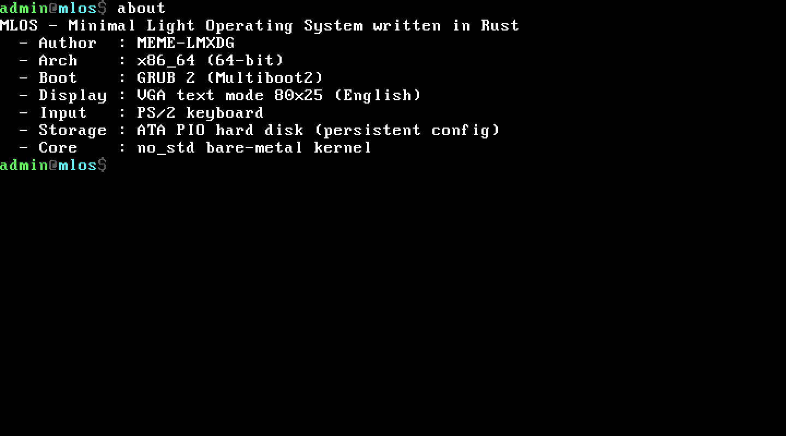 |
| Performance monitor (`perf`) | 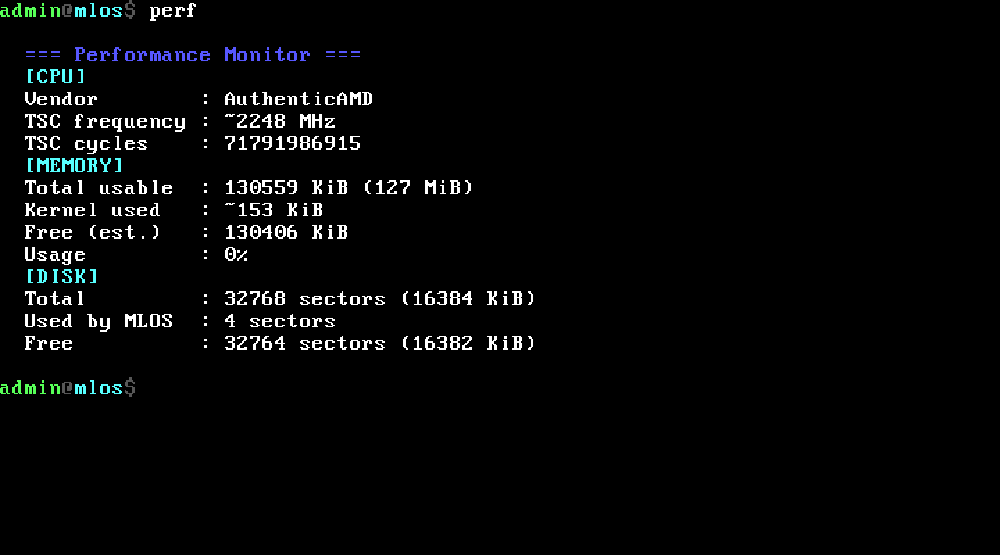 |
| File listing (`ls`) | 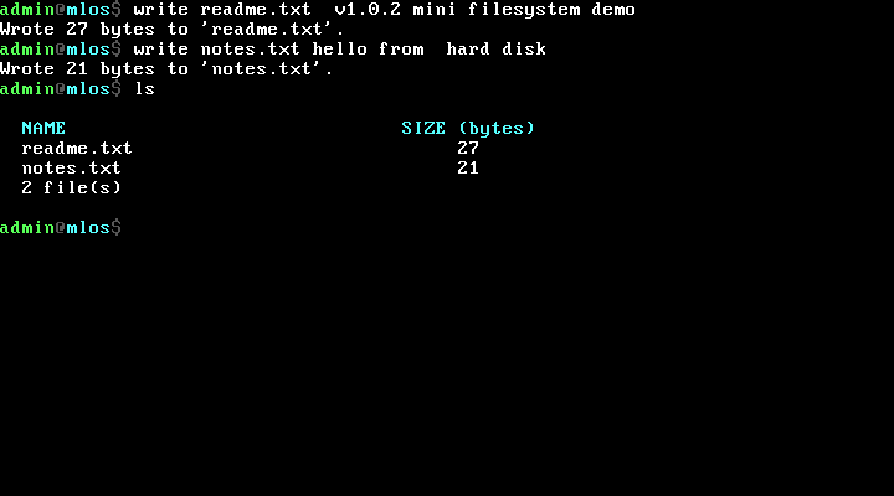 |
| File content (`cat`) | 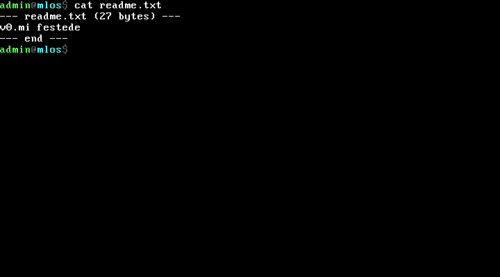 |
| File delete (`rm`) | 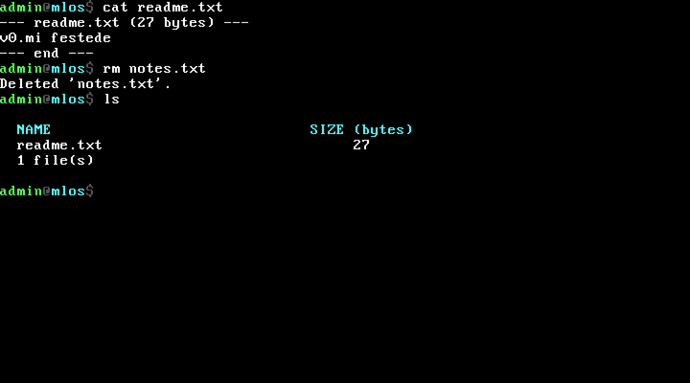 |
| Disk status (`disk`) | 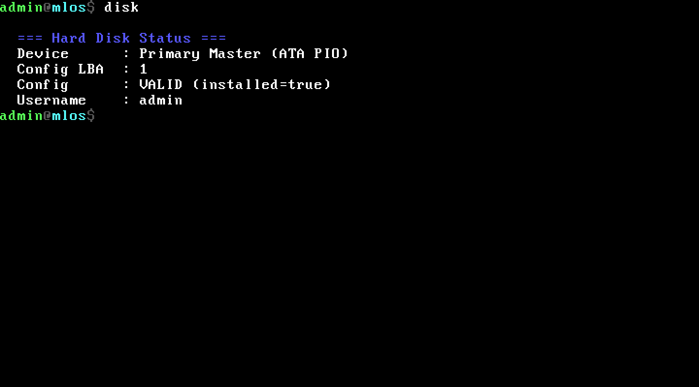 |
| Update check (`update`) | 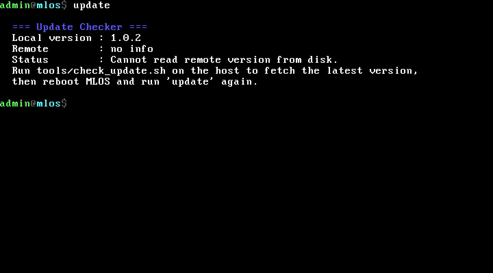 |
| Games menu | 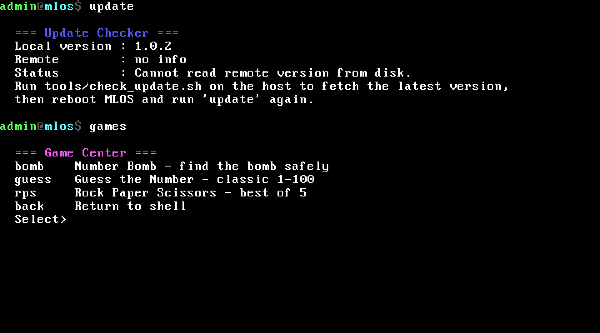 |
| GUI startup warning (experimental confirmation) | 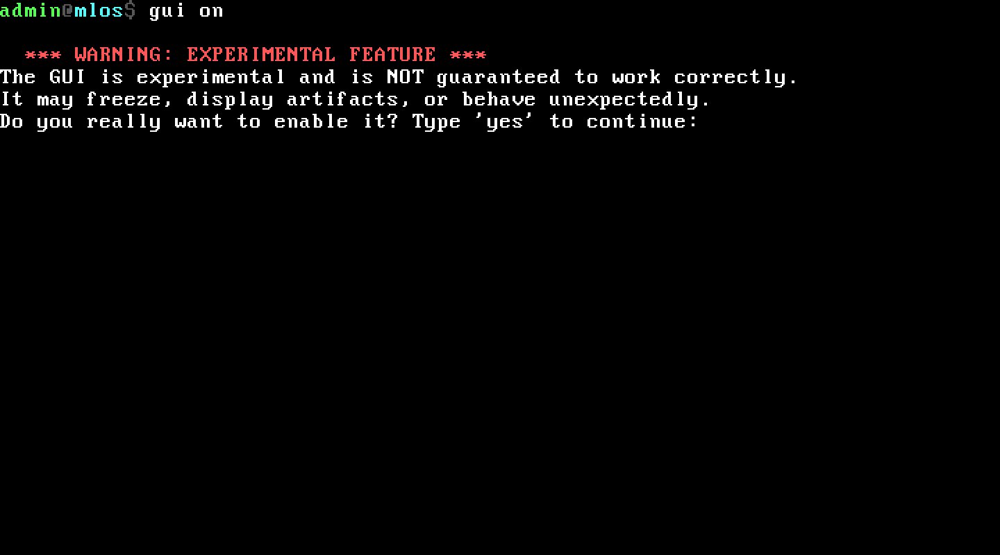 |
| GUI desktop (after `gui on`) | 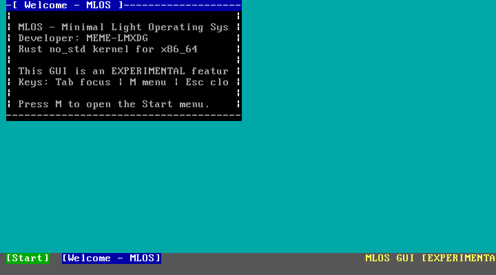 |
| GUI Start menu | 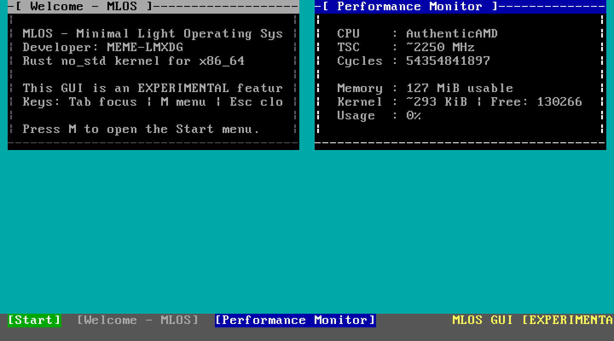 |
| GUI performance monitor |  |
| GUI file viewer | 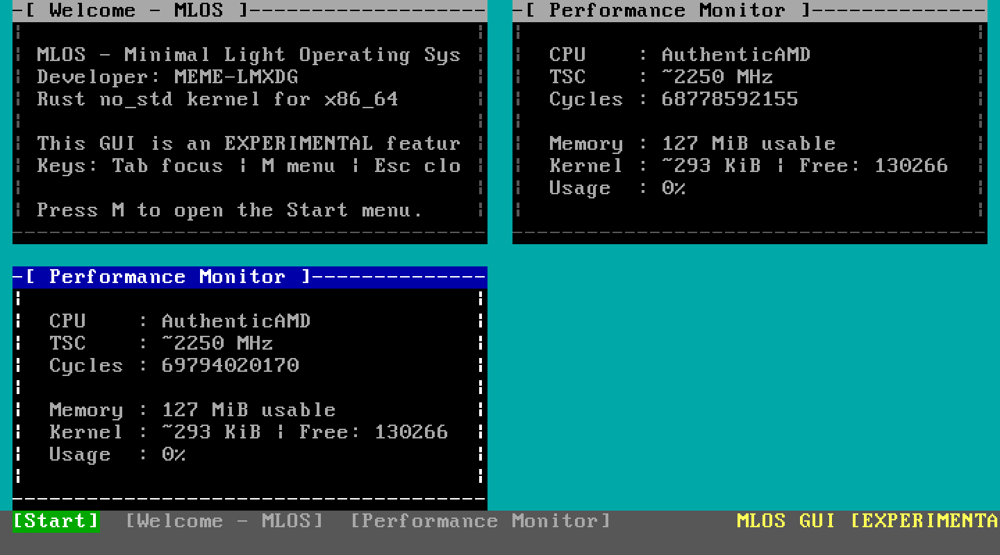 |
| Setup wizard | 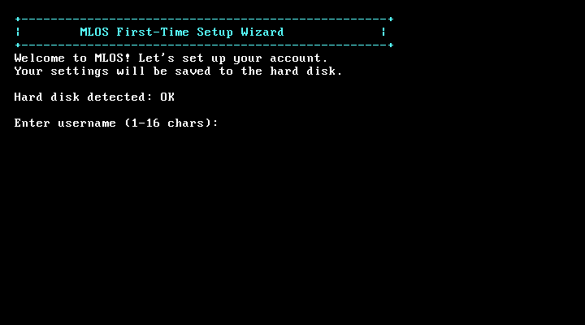 |
| System written to disk (ISO-free boot) | 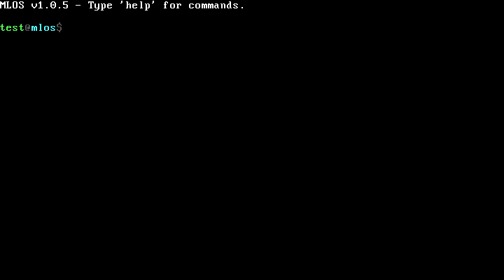 |
| Boot from hard disk -> login | 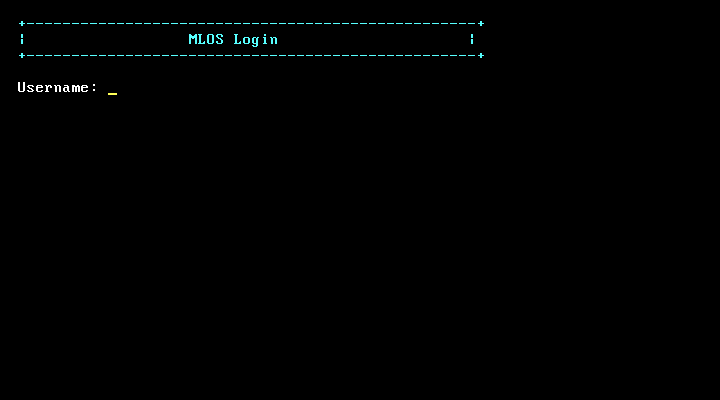 |
| Boot from hard disk -> shell |  |

---

## Commands

```
help  man     clear   echo    history exit    logout  reboot  halt
pwd   cd      ls      cat     write   touch   rm      grep
version  uname  about  whoami  who    id      hostname  date    uptime
mem   free    df      ps      top     perf    disk    usb     resolution
lang  color   banner  setup   bootinstall    update  gui
games bomb    guess   rps     tools   calc    base    prime   hash    rand    ascii
```

See `help` for the full list and `man <command>` for usage.bash
# Create a persistent 16 MB raw disk image
qemu-img create -f raw mlos-disk.img 16M

# Boot (BIOS mode, CD first)
qemu-system-x86_64 -cdrom MLOS.iso -m 128M -boot d -net none \
  -drive file=mlos-disk.img,format=raw,if=ide,index=0,media=disk
```

Options: add `-vga std` for a standard VGA card, `-display gtk` / `-display sdl` to show a window (default), `-serial stdio` for serial logging if you build a debug kernel.

### 2. VirtualBox

1. **New** → Name: `MLOS`, Type: `Other`, Version: `Other/Unknown` (or DOS)
2. Memory: **128 MB** or more
3. Hard disk: **Create a virtual hard disk now** → VHD or VDI, ≥ 16 MB (use `Fixed size` or dynamic; attach it as the **IDE Primary Master**)
4. VM **Settings → Storage**: attach `MLOS.iso` to the **IDE Secondary Master** (optical drive)
5. Settings → **System → Boot Order**: put **Optical** first
6. Settings → **System → Acceleration/Processor**: leave defaults; **do not enable EFI** (System → Motherboard → *Enable EFI* must be OFF)
7. Start the VM. First boot runs the setup wizard; afterwards remove the ISO (Storage → remove disk from virtual drive) and boot from the hard disk.

### 3. VMware (Workstation Pro / Player / Fusion)

1. **Create a New Virtual Machine** → choose **I will install the operating system later**
2. Guest OS: **Other** → Version: **Other** (a 64-bit guest is fine, BIOS firmware is the default)
3. Memory: 128 MB or more
4. Disk: create a new virtual disk (IDE recommended), ≥ 16 MB
5. **Edit virtual machine settings → CD/DVD (IDE)**: *Use ISO image file* → select `MLOS.iso`, check **Connect at power on**
6. Firmware: keep **BIOS** (Options → Advanced → Firmware type: BIOS; do not select EFI)
7. Power on. After the first-boot setup, eject the ISO from the CD/DVD device and boot from disk.

### 4. Bochs

`bochsrc`:

```
megs: 128
boot: cdrom
ata0-master: type=disk, path="mlos-disk.img", mode=flat, cylinders=32, heads=16, spt=63
ata0-slave: type=cdrom, path="MLOS.iso", status=inserted
```

Run: `bochs -q` (create `mlos-disk.img` with `bximage -hd -size=16 -imgmode=flat mlos-disk.img`).

### 5. Hyper-V (Windows)

1. Hyper-V Manager → **New → Virtual Machine**
2. Generation: **Generation 1** (BIOS firmware; Generation 2 is UEFI-only and will not boot)
3. Memory: 128 MB startup RAM, disable dynamic memory if issues occur
4. Networking: disconnect (not required)
5. Virtual hard disk: create a small VHD (≥ 16 MB), attach it to the IDE controller
6. Installation options: *Install an operating system from a bootable CD/DVD* → image file → `MLOS.iso`
7. After setup, remove the ISO from the VM's DVD drive and boot from the virtual hard disk.

### First boot flow (all VMs)

1. Boot from the ISO → setup wizard → set username & password
2. The config is written to the virtual hard disk and survives reboots
3. Log in → try `perf`, `write`, `ls`, `cat`, `games`, `update`

---

## Build from Source

Requirements: Rust (1.93.0 recommended) with `rust-src`, `grub-mkrescue`, `xorriso`, `mtools`, QEMU.

```bash
# Build the kernel and ISO
make iso          # produces MLOS.iso
```

### Update check

```bash
# On the host: fetch the latest GitHub release tag into the disk image
./tools/check_update.sh mlos-disk.img
# Then boot MLOS and run:  update
```

---

## Project Layout

```
MLOS/
├── src/
│   ├── main.rs          # kernel entry, banner, memory-map parsing
│   ├── boot.rs          # 32-bit → 64-bit long mode trampoline
│   ├── vga.rs           # VGA text-mode terminal + bilingual print macros
│   ├── zhfont.rs        # Chinese preview: VGA font reprogramming + slot manager
│   ├── zhfont_data.rs   # generated Han bitmap font (gen_zhfont.py)
│   ├── keyboard.rs      # PS/2 keyboard driver
│   ├── mouse.rs         # PS/2 mouse driver (click / coordinate mapping)
│   ├── input.rs         # line editing helpers
│   ├── io.rs            # port I/O (inb/outb/rdtsc...)
│   ├── ata.rs           # ATA PIO disk driver (read/write/identify)
│   ├── storage.rs       # user config persistence (LBA 1)
│   ├── fs.rs            # MiniFS file store (LBA 4+)
│   ├── perf.rs          # performance monitor (CPUID/TSC/PIT)
│   ├── update.rs        # version compare + remote info (LBA 3)
│   ├── setup.rs         # setup wizard + login
│   ├── shell.rs         # interactive shell
│   ├── games.rs         # games
│   ├── tools.rs         # tools
│   └── rng.rs           # xorshift64* random numbers
├── tools/
│   ├── check_update.sh  # host-side update fetcher
│   └── gen_zhfont.py    # regenerate the Chinese bitmap font
├── screenshots/         # system screenshots (English UI)
├── grub.cfg             # GRUB menu
├── linker.ld            # kernel linker script
├── x86_64-os.json       # custom Rust target
└── Makefile             # build / iso / run targets
```

---

## Disk Layout (MiniFS & system sectors)

| LBA | Purpose |
|-----|---------|
| 1   | User configuration (magic `MLOS`, username, FNV-1a password hash, language preference, checksum) |
| 3   | Remote version info (magic `UPDT`, written by `tools/check_update.sh`) |
| 4   | MiniFS directory (magic `MFSD`, 12 entries) |
| 5+  | MiniFS file data, 8 sectors (4 KB) per slot |

## License

MIT
