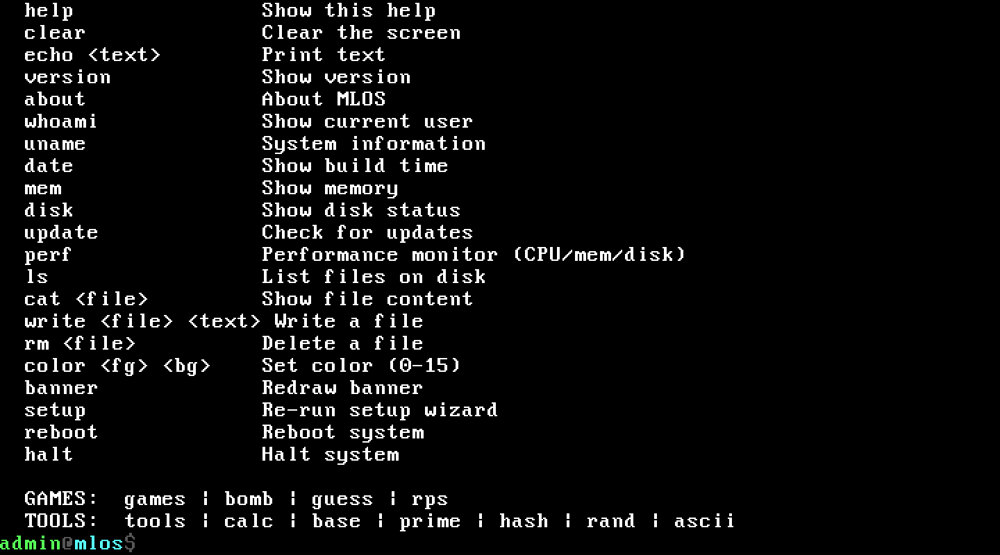
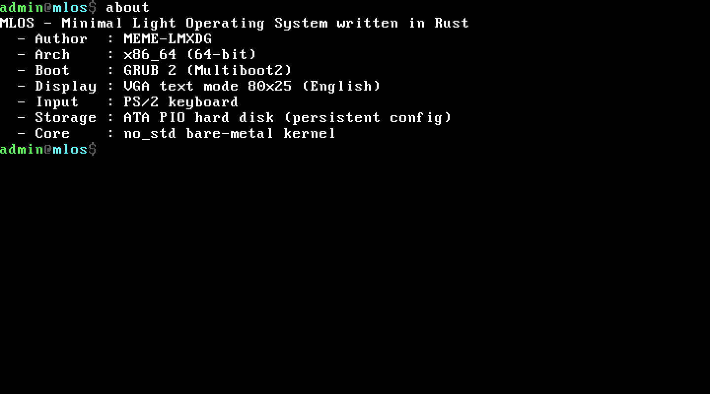
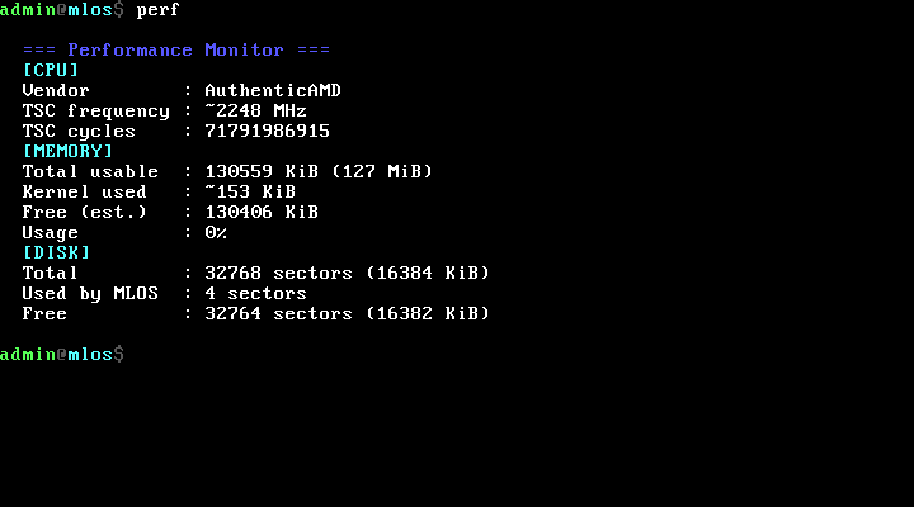
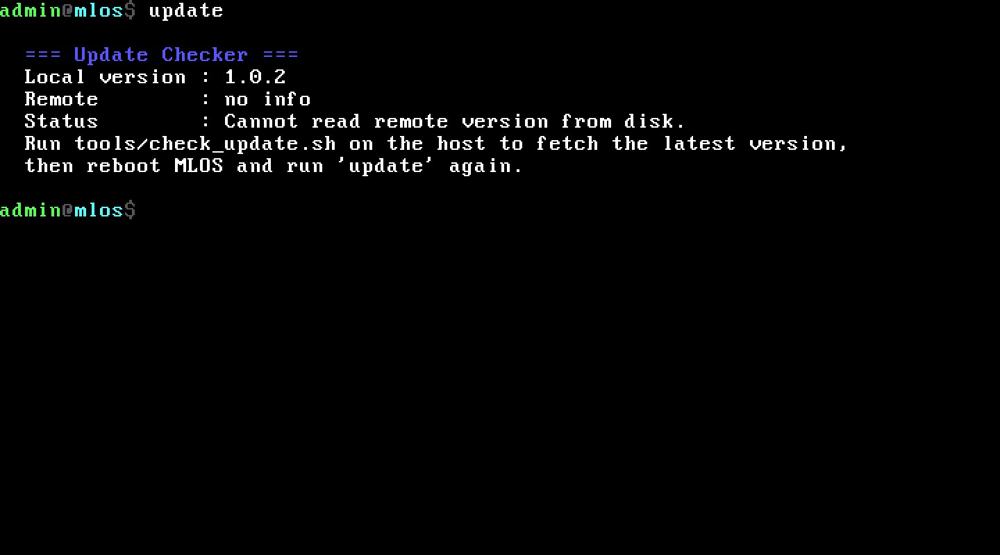
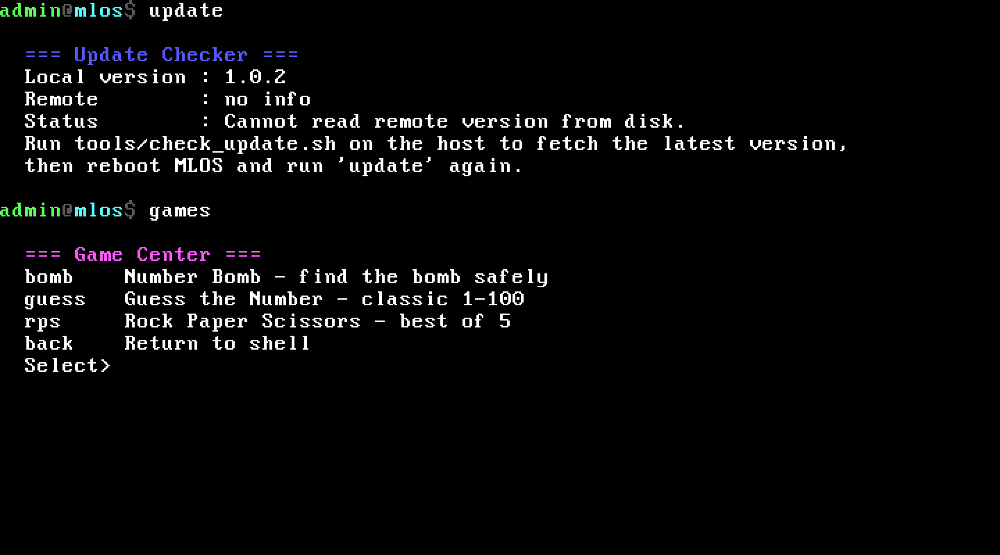

# MLOS

**MLOS**（Minimal Light Operating System，极轻量操作系统）是一个使用 Rust 从零编写的 64 位操作系统，以约 5 MB 的可引导 ISO 镜像交付。它基于 GRUB 2（Multiboot2）在 BIOS 模式下启动，内置交互式 Shell、性能监视器、文件浏览器、安装向导与密码登录、硬盘数据持久化、小游戏和实用工具。

- **开发者**：MEME-LMXDG
- **版本**：1.0.2
- **语言**：Rust（`no_std` 裸机内核，x86_64）
- **仓库**：<https://github.com/lmxdg/MLOS>
- **发布页**：<https://github.com/lmxdg/MLOS/releases>

---

## 系统特性

### 核心系统
- 纯 Rust 编写的 64 位裸机内核（`no_std`、`no_main`）
- Multiboot2 引导头 + GRUB 2，32 位保护模式 → 64 位长模式切换
- VGA 文本模式显示（80×25，CP437），硬件光标
- PS/2 键盘驱动，完整美式布局（Shift、退格、回车）
- 通过 Multiboot2 内存映射检测可用内存

### 安装与登录
- 首次启动进入安装向导：设置用户名与密码
- 密码以 FNV-1a 哈希写入硬盘，绝不存明文
- 之后每次启动都需要登录验证

### 硬盘持久化
- ATA PIO（LBA28）驱动，操作主硬盘
- 用户配置写入 LBA 1 扇区（魔数 + 校验和）
- MiniFS 文件存储区，可在硬盘中保存用户文件

### 性能监视器（`perf`）
- **CPU**：通过 CPUID 读取厂商信息，TSC 频率经 PIT 校准，实时周期计数
- **内存**：可用总量、内核占用、剩余内存与使用率
- **硬盘**：通过 ATA IDENTIFY 获取容量、MLOS 已用扇区、剩余空间

### 文件浏览器（`ls` / `cat` / `write` / `rm`）
- MiniFS：建立在原始硬盘扇区上的简易文件存储（目录扇区位于 LBA 4，共 12 个文件槽位 × 4 KB）
- 在 Shell 中直接创建、列出、查看和删除文本文件

### 在线更新检测（`update`）
- 对比本地版本与 GitHub 最新 Release 版本号
- MLOS 内核本身不带网络栈；配套主机脚本 `tools/check_update.sh` 从 GitHub 拉取最新版本号写入硬盘 LBA 3 扇区，随后 `update` 命令会报告：*已是最新*、*发现新版本*（附下载地址）或*未获取到信息*

### 小游戏
- 数字炸弹、猜数字、石头剪刀布

### 实用工具
- 计算器、进制转换、素数判断、FNV-1a 文本哈希、随机数、ASCII 表

---

## 系统截图

| | |
|---|---|
| Shell 与横幅 |  |
| 帮助信息 |  |
| 关于系统 |  |
| 性能监视器（`perf`） |  |
| 文件列表（`ls`） |  |
| 文件内容（`cat`） |  |
| 删除文件（`rm`） |  |
| 硬盘状态（`disk`） |  |
| 更新检测（`update`） |  |
| 游戏菜单 |  |

---

## 命令列表

```
help    clear   echo    version about   whoami  uname   date    mem
perf    ls      cat     write   rm      disk    update  color   banner
setup   reboot  halt    games   bomb    guess   rps     tools   calc
base    prime   hash    rand    ascii
```

---

## 构建与运行

环境要求：Rust（推荐 1.93.0）及 `rust-src` 组件、`grub-mkrescue`、`xorriso`、`mtools`、QEMU。

```bash
# 构建内核并打包 ISO
make iso          # 生成 MLOS.iso

# 在 QEMU 中运行（BIOS 启动，附带 16 MB 持久化硬盘）
qemu-img create -f raw mlos-disk.img 16M
qemu-system-x86_64 -cdrom MLOS.iso -m 128M -boot d -net none \
  -drive file=mlos-disk.img,format=raw,if=ide,index=0,media=disk
```

首次启动进入安装向导；重启后使用你设置的用户名和密码登录。

> **注意**：ISO 使用 GRUB `i386-pc` 引导，需 BIOS（传统）模式，不支持纯 UEFI 启动。

### 更新检测

```bash
# 在宿主机上执行：把 GitHub 最新 Release 版本号写入硬盘镜像
./tools/check_update.sh mlos-disk.img
# 然后启动 MLOS，登录后运行：update
```

---

## 项目结构

```
MLOS/
├── src/
│   ├── main.rs          # 内核入口、横幅、内存映射解析
│   ├── boot.rs          # 32 位 → 64 位长模式切换
│   ├── vga.rs           # VGA 文本模式终端 + 打印宏
│   ├── keyboard.rs      # PS/2 键盘驱动
│   ├── input.rs         # 行编辑辅助
│   ├── io.rs            # 端口 I/O（inb/outb/rdtsc 等）
│   ├── ata.rs           # ATA PIO 硬盘驱动（读/写/识别）
│   ├── storage.rs       # 用户配置持久化（LBA 1）
│   ├── fs.rs            # MiniFS 文件存储（LBA 4 起）
│   ├── perf.rs          # 性能监视器（CPUID/TSC/PIT）
│   ├── update.rs        # 版本对比 + 远端版本信息（LBA 3）
│   ├── setup.rs         # 安装向导 + 登录
│   ├── shell.rs         # 交互式 Shell
│   ├── games.rs         # 小游戏
│   ├── tools.rs         # 实用工具
│   └── rng.rs           # xorshift64* 随机数
├── tools/
│   └── check_update.sh  # 主机侧更新拉取脚本
├── screenshots/         # 系统截图（英文界面）
├── grub.cfg             # GRUB 菜单
├── linker.ld            # 内核链接脚本
├── x86_64-os.json       # 自定义 Rust target
└── Makefile             # 构建 / ISO / 运行目标
```

---

## 硬盘布局（系统扇区与 MiniFS）

| LBA | 用途 |
|-----|------|
| 1   | 用户配置（魔数 `MLOS`、用户名、FNV-1a 密码哈希、校验和） |
| 3   | 远端版本信息（魔数 `UPDT`，由 `tools/check_update.sh` 写入） |
| 4   | MiniFS 目录扇区（魔数 `MFSD`，12 个条目） |
| 5+  | MiniFS 文件数据，每槽位 8 个扇区（4 KB） |

## 许可证

MIT
