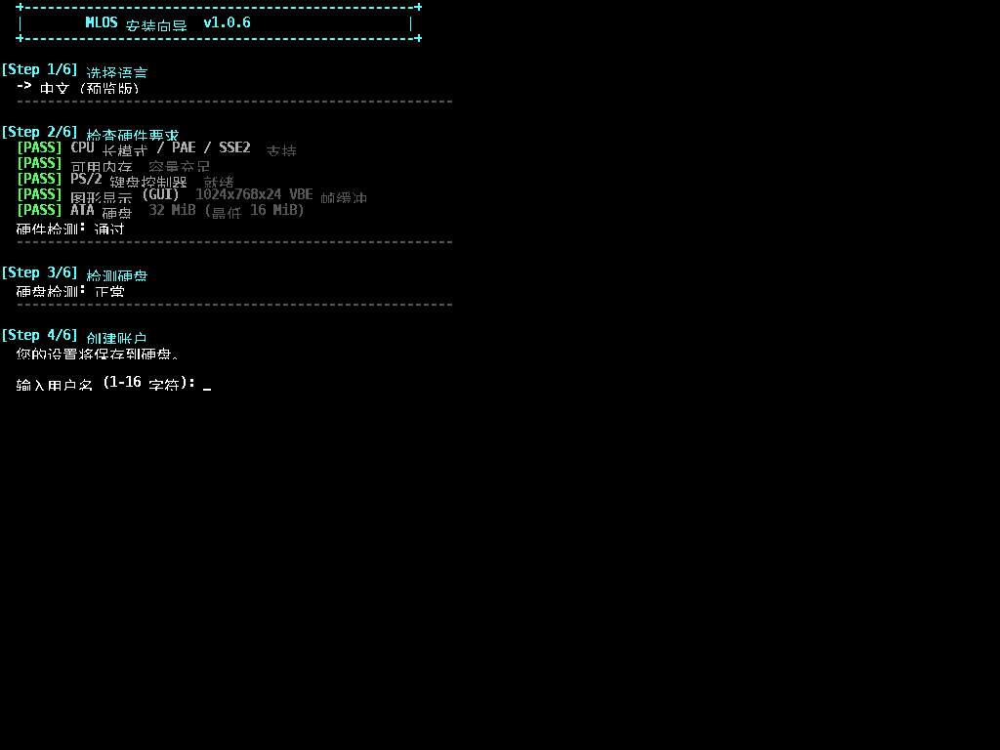
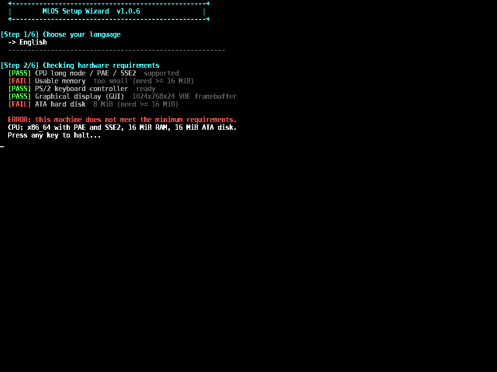
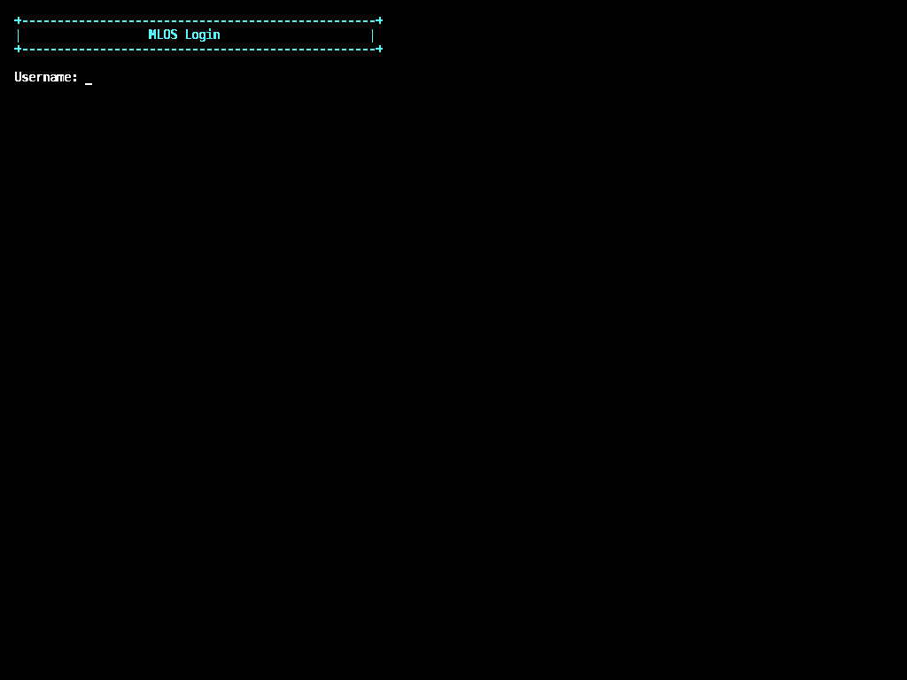
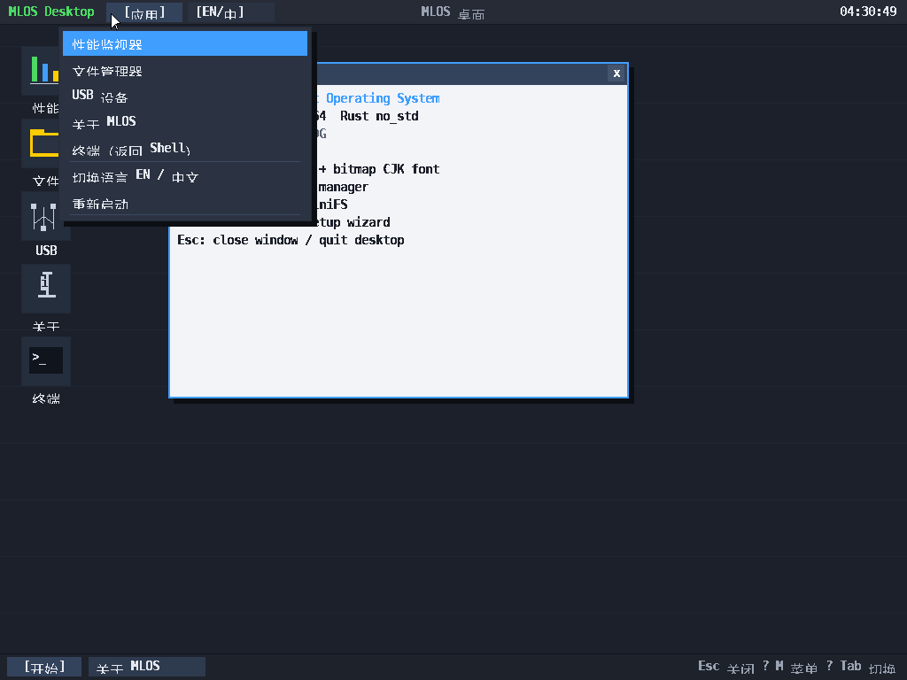
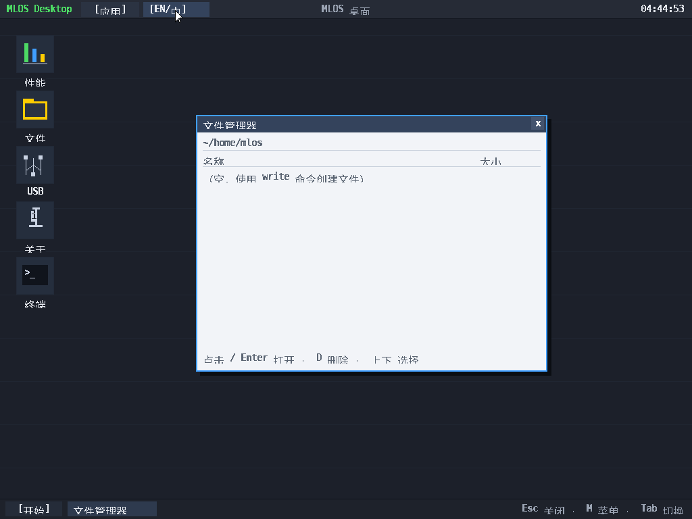
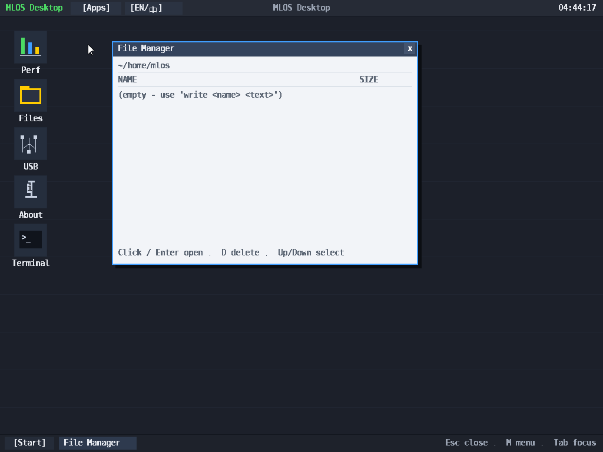
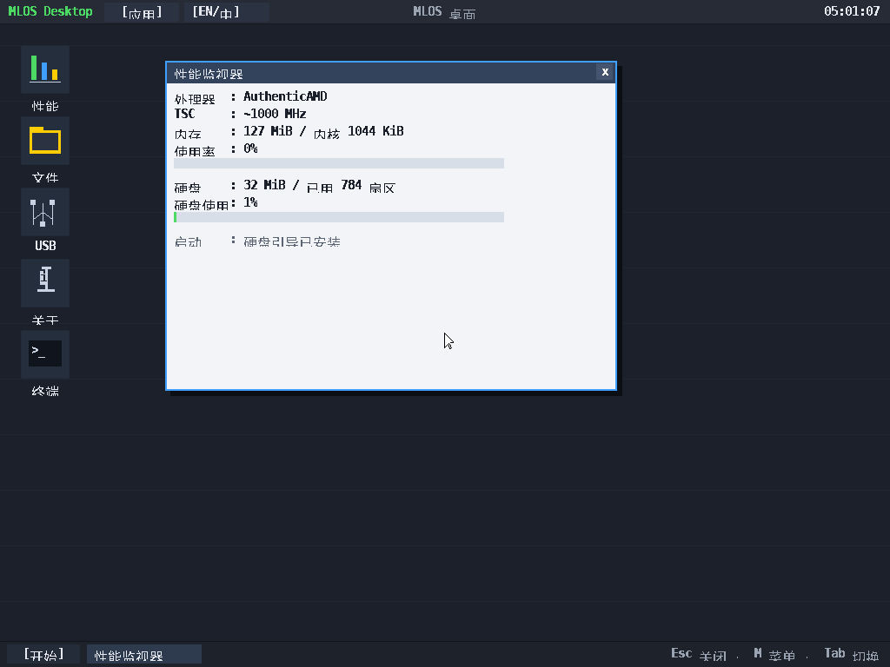
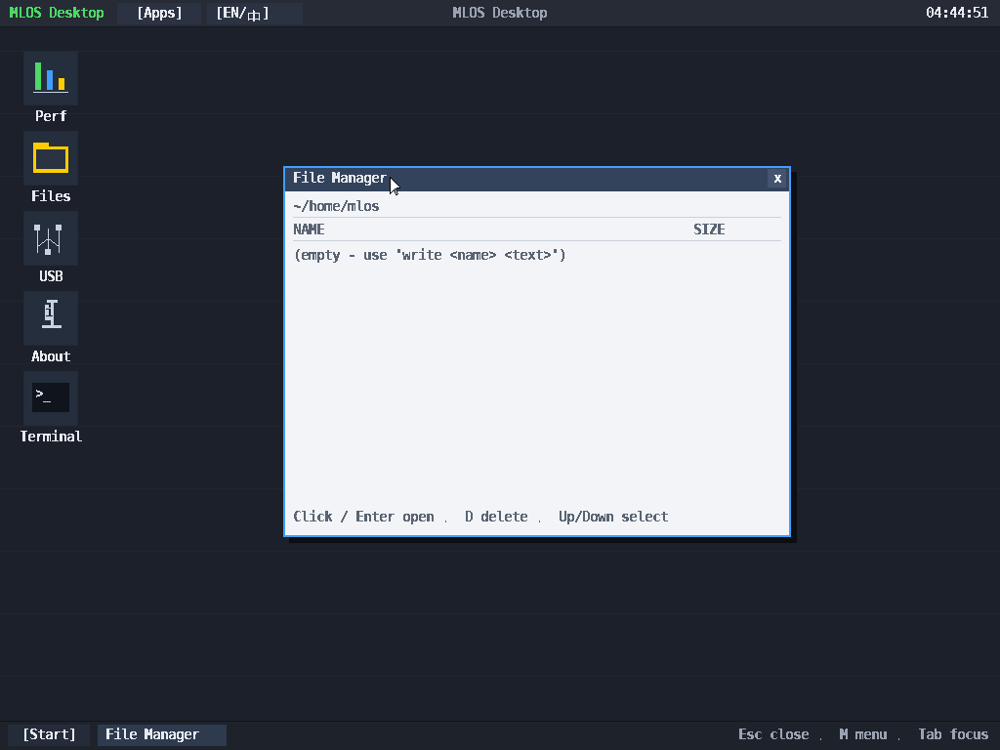

# MLOS

简体中文 | [English](README.en.md)

**MLOS**（Minimal Light Operating System）是一个使用 Rust 从零编写的 64 位裸机操作系统。当前版本 **v1.0.6** 使用 VBE 线性帧缓冲绘制图形控制台与桌面，直接渲染 8×16 ASCII 与 16×16 中文点阵；ISO 自带两阶段引导装载器，**不需要 GRUB / xorriso**，同时支持安装到硬盘后免 ISO 启动。

- **开发者**：MEME-LMXDG
- **语言**：Rust（`no_std` / `no_main`，x86_64）
- **仓库**：<https://github.com/lmxdg/MLOS>
- **下载页**：<https://github.com/lmxdg/MLOS/releases>

---

## 本版重点修复与改进

- **修复 GUI 无法正常显示**：颜色高/低半字节颠倒、窗口文本使用 VGA 文本模式字形等根因已修复；桌面改为像素级绘制
- **中文乱码修复 + 新的中文渲染方式**：不再把汉字塞进 VGA 字模槽，而是把 16×16 点阵直接绘制到 VBE 帧缓冲；取消 64 字槽限制，同屏汉字不再互相覆盖
- **鼠标指针改为箭头**：12×19 像素箭头，带黑色描边；只重绘指针所在小区域，移动流畅
- **安装程序增加硬件要求检测**：CPU 长模式/PAE/SSE2、可用内存、ATA 硬盘容量、PS/2 控制器、VBE 图形显示；不满足时拒绝安装
- **操作逻辑更像 Linux**：命令历史（↑/↓）、Tab 补全、Ctrl+C/Ctrl+L/Ctrl+U、`cd` 路径规范化、`cd -`、`cp/mv/find/stat/wc/head/tail/tree`、`echo >` 重定向、`passwd`、`lscpu/lspci/dmesg/hw` 等
- **修复 MiniFS 读取字节序错误**：此前 `cat/head/wc/grep` 会把文本读成二进制
- **修复引导与初始化顺序**：先初始化显示，再绘制开机画面；页表恒等映射低 4 GiB 以覆盖位于 `0xFD000000` 附近的 VBE 帧缓冲
- **修复鼠标初始化**：8042 配置字节读取、ACK 处理、只消费 AUX 数据，避免吃掉键盘扫描码
- **修复硬盘安装/自引导**：stage2 改为 32 KiB 并加载到 `0x7E00`，避免覆盖自身；只转储内核加载段，BSS 由内核启动时清零

---

## 硬件要求

| 项目 | 最低要求 | 说明 |
|------|----------|------|
| CPU | x86_64，支持 PAE + SSE2 | 长模式启动必需 |
| 内存 | **16 MiB** 可用 | 1024×768×24 帧缓冲约 2.25 MiB |
| 硬盘 | **16 MiB** ATA/IDE | 安装配置、MiniFS 与硬盘引导 |
| 显示 | VBE 2.0 线性帧缓冲 ≥ 800×600 | 无帧缓冲时回退 VGA 文本模式，GUI 不可用 |
| 输入 | PS/2 键盘 / 鼠标 | 鼠标可选，键盘始终可用 |
| 固件 | **BIOS / CSM（传统启动）** | 目前不支持纯 UEFI |

安装向导第 2 步会逐项显示 `[PASS]/[FAIL]`，关键项失败时停机并给出原因。

---

## 首次启动（6 步安装向导）

1. **选择语言**：English / 中文
2. **硬件要求检测**：CPU、内存、PS/2、VBE、ATA 容量
3. **硬盘检测**：确认 Primary Master ATA 硬盘可用
4. **创建账户**：用户名 + 密码（FNV-1a 哈希写入硬盘）
5. **安装系统**：把 stage2、内核镜像写入硬盘；旋转动画显示进度
6. **完成**：直接进入 Shell；之后可随时 `bootinstall` 重装硬盘引导

后续启动需要登录；`exit`/`logout` 注销，`passwd` 修改密码，`setup` 重跑向导。

---

## 显示与中文渲染

- 引导程序通过 VBE 设置线性图形模式（优先 1024×768×32，兼容 24 bpp），并在 Multiboot2 信息中写入 framebuffer tag
- 内核把所有物理内存低 4 GiB 用 2 MiB 大页恒等映射，帧缓冲可直接写入
- 控制台与 GUI 使用两套内置点阵：
  - `src/ascii_font_data.rs`：DejaVu Sans Mono Bold 8×16 ASCII
  - `src/zhfont_data.rs`：Noto Sans CJK SC 16×16 汉字/中文标点，每个字拆成左右两个 8×16 半字形
- 中文直接按 UTF-8 解码后绘制，**不占用 VGA 字模槽**，不存在“同屏超过 64 个汉字就乱码”的问题
- 无 VBE 时回退 VGA 文本模式：ASCII 使用 ROM 字模，中文使用 `0xA0000` 字符发生器 RAM 的动态字模（该回退路径每个屏幕最多 64 个不同汉字）

字库由 `tools/gen_ascii_font.py` 与 `tools/gen_zhfont.py` 从系统源码字符串自动收集生成；新增中文文案后重新运行脚本即可。

---

## 图形桌面

输入 `gui` 启动桌面：

- 顶部面板：MLOS 标识、`[Apps]/[应用]` 菜单、`[EN/中]` 语言切换、实时时钟
- 左侧桌面图标：性能监视器、文件管理器、USB 设备、关于、终端（返回 Shell）
- 窗口：可拖动标题栏、置顶聚焦、右上角 `x` 关闭；底部任务栏显示窗口按钮
- 文件管理器：列出 MiniFS 文件，点击行或 Enter 打开文件查看器；`D` 删除
- 文件查看器：中文自动换行、上下滚动
- 箭头鼠标指针：12×19 像素，白色填充 + 黑色描边
- 键盘快捷键：`Esc` 关闭窗口/退出桌面，`Tab` 切换窗口，`M` 菜单，`L` 切换语言，方向键/Enter 操作

---

## 类 Linux Shell

提示符：`user@mlos:~$`，支持逻辑工作目录与 `~` 缩写。

常用命令：

```
help man clear echo history exit logout reboot halt passwd
pwd cd ls ll la cat write touch rm mkdir grep head tail wc cp mv find stat tree
version uname about whoami who id hostname date uptime env
mem free df ps top perf disk usb resolution lscpu lspci lsusb dmesg hw
lang color banner setup bootinstall update gui demo
games bomb guess rps tools calc base prime hash rand ascii
```

输入编辑：

- `↑` / `↓`：命令历史
- `Tab`：命令/文件名补全
- `Ctrl+C`：取消当前行
- `Ctrl+L`：清屏
- `Ctrl+U`：删除整行
- `echo <文本> > <文件>` / `>>`：写入或追加文本
- `demo`：创建中文示例文件 `welcome.txt`

---

## 在虚拟机中运行

> ISO 为 **BIOS El Torito** 引导，请在虚拟机中启用 BIOS/CSM，不要使用纯 UEFI。

```bash
# 32 MiB 持久化硬盘
truncate -s 32M mlos-disk.img

qemu-system-x86_64 -cdrom MLOS.iso -m 128M -boot d -net none \
  -vga std \
  -drive file=mlos-disk.img,format=raw,if=ide,index=0,media=disk
```

首次启动进入安装向导。安装完成后可移除 ISO，从硬盘启动：

```bash
qemu-system-x86_64 -m 128M -boot c -net none -vga std \
  -drive file=mlos-disk.img,format=raw,if=ide,index=0,media=disk
```

VirtualBox / VMware / Hyper-V 请使用第一代/BIOS 虚拟机，挂载 ISO 到 IDE 光驱并添加 ≥16 MiB IDE 硬盘。

---

## 从源码构建

环境要求：

- Rust（stable，含 `rust-src`；Makefile 使用 `RUSTC_BOOTSTRAP=1` 构建 `core/alloc`）
- NASM（汇编 MBR / stage2 / ISO 引导镜像）
- Python 3 + [`pycdlib`](https://pypi.org/project/pycdlib/)（生成 ISO9660 + El Torito）
- 可选：QEMU（运行测试）

```bash
make boot     # 汇编 boot/mbr.bin、stage2.bin、isoboot.bin
make kernel   # 交叉构建内核
make iso      # 生成 MLOS.iso（自带引导，无需 GRUB）
make run      # QEMU 启动 ISO + 32 MiB 硬盘
```

生成字库（修改中文文案后执行）：

```bash
python3 tools/gen_ascii_font.py
python3 tools/gen_zhfont.py
make iso
```

> `grub.cfg` 与 Multiboot2 framebuffer 请求标签仍保留，便于使用 GRUB 引导；但不是必须。

---

## 项目结构

```
MLOS/
├── boot/
│   ├── mbr.asm          # 硬盘引导 stage1（EDD 读取 64 扇区 stage2）
│   ├── stage2.asm       # 硬盘引导 stage2：VBE + e820 + MB2 + 内核加载
│   ├── isoboot.asm      # ISO El Torito 引导镜像（内嵌内核，VBE 初始化）
│   └── vbe.inc          # VBE 模式设置与 framebuffer tag 构建
├── src/
│   ├── main.rs          # 内核入口、内存映射、panic
│   ├── boot.rs          # Multiboot2 头 + 长模式 + 4 GiB 页表
│   ├── fb.rs            # VBE 帧缓冲像素/文本绘制
│   ├── font.rs          # ASCII/CJK 点阵查询
│   ├── vga.rs           # 控制台抽象（framebuffer / VGA 文本回退）
│   ├── zhfont.rs        # 文本模式回退：VGA 字模 RAM 重编程
│   ├── ascii_font_data.rs / zhfont_data.rs  # 自动生成字库
│   ├── cursor.rs        # 像素箭头鼠标指针
│   ├── gui.rs           # 像素级窗口桌面
│   ├── mouse.rs         # PS/2 鼠标（AUX 数据、有界等待）
│   ├── keyboard.rs      # PS/2 键盘（Ctrl/方向键/Tab）
│   ├── hw.rs            # 硬件要求检测
│   ├── rtc.rs           # CMOS 实时时钟
│   ├── ata.rs/fs.rs/storage.rs/update.rs   # 磁盘、MiniFS、配置、更新
│   ├── installer.rs     # 把 stage2 + 内核写入硬盘
│   ├── setup.rs         # 6 步安装向导与登录
│   ├── shell.rs         # 类 Linux Shell
│   ├── splash.rs        # 开机画面
│   ├── games.rs/tools.rs/rng.rs/perf.rs/usb.rs/video.rs/io.rs/input.rs
├── tools/
│   ├── mkiso.py         # ELF → 扁平镜像 → El Torito ISO
│   ├── gen_ascii_font.py
│   ├── gen_zhfont.py
│   └── check_update.sh
├── screenshots/
├── linker.ld
├── x86_64-os.json
└── Makefile
```

---

## 硬盘布局

| LBA | 用途 |
|-----|------|
| 0   | MBR（stage1） |
| 1   | 用户配置（`MLOS` 魔数、用户名、FNV-1a 哈希、语言、校验和） |
| 3   | 远端版本信息（`UPDT`，由 `tools/check_update.sh` 写入） |
| 4   | MiniFS 目录扇区（`MFSD`，12 个条目） |
| 5+  | MiniFS 文件数据，每槽 8 扇区（4 KiB） |
| 2048..2111 | stage2（32 KiB） |
| 4096 | 内核头（`MLBX`、扇区数、入口偏移） |
| 4097+ | 内核扁平镜像（仅加载段；BSS 由启动代码清零） |

---

## 截图

| | |
|---|---|
| 开机画面 |  |
| 安装向导 · 硬件要求检测（中文） |  |
| 安装向导 · 硬件要求检测（英文） |  |
| 硬件不满足时拒绝安装 |  |
| 登录（中文） |  |
| 硬盘直接启动 · 登录（英文） |  |
| Shell（中文） |  |
| Shell 命令演示（英文） |  |
| 桌面（英文） |  |
| 应用菜单（中文） |  |
| 文件管理器（中文） |  |
| 文件管理器（英文） |  |
| 文件查看器（中文） |  |
| 性能监视器（中文） |  |
| 拖动窗口 |  |
| 硬盘引导安装成功 |  |

## 已知限制

- 仅支持 BIOS/CSM 启动；纯 UEFI 需要额外的 GOP framebuffer 支持
- 中文输入法尚未实现（Shell 只接受 ASCII 输入）；中文显示、中文文件内容渲染均正常
- MiniFS 为扁平文件系统，无目录层级；“目录”仅体现在 Shell 的逻辑路径提示符中
- 内核没有抢占式调度/网络栈/文件权限；这是教学/演示型轻量系统

## 许可证

MIT