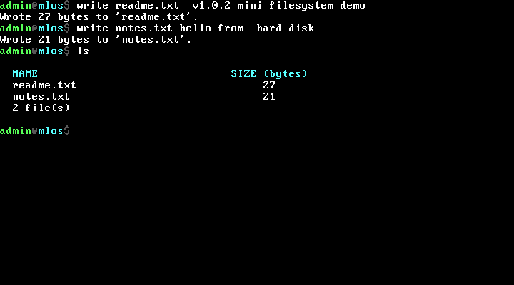
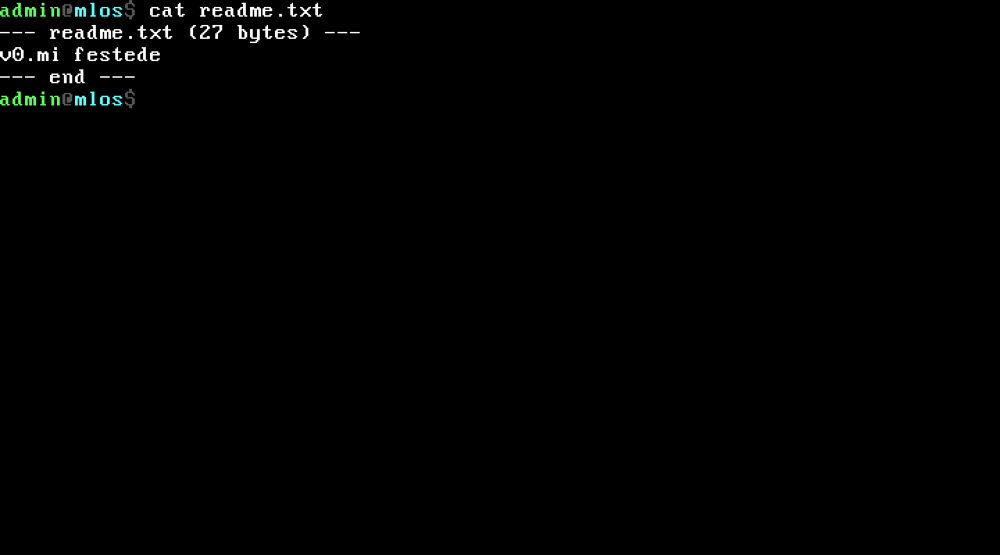
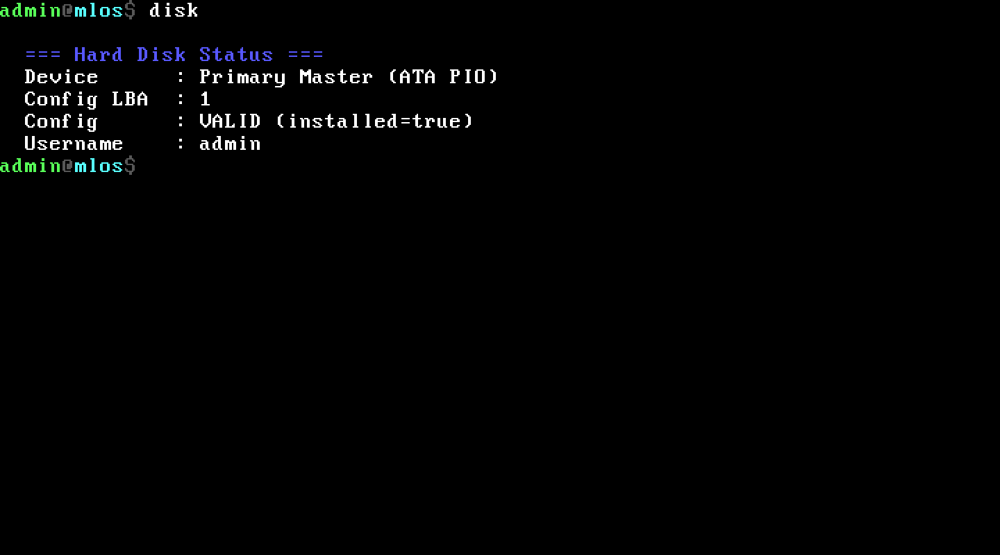
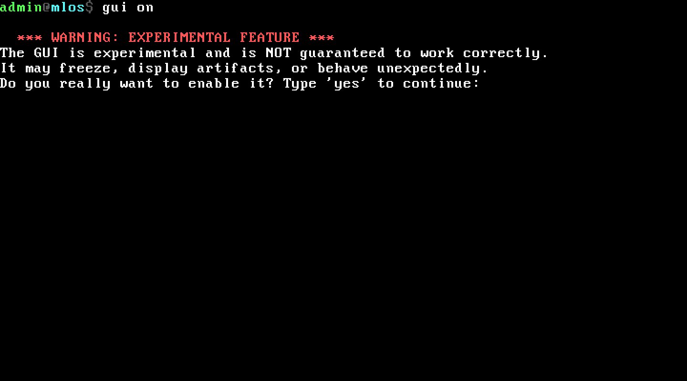
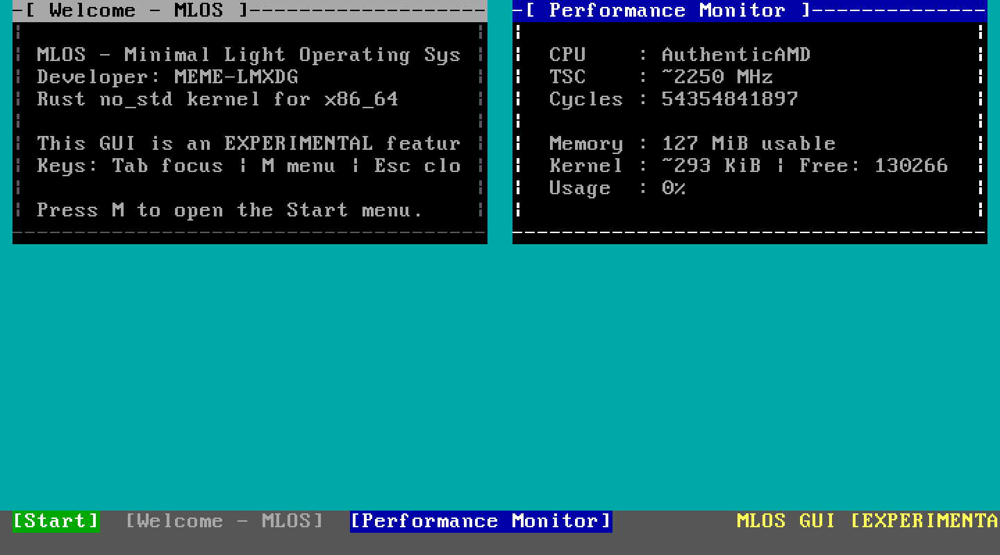
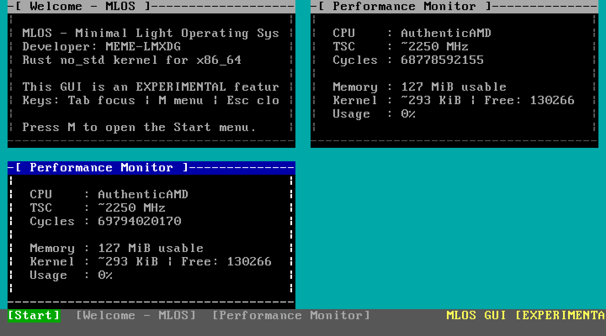
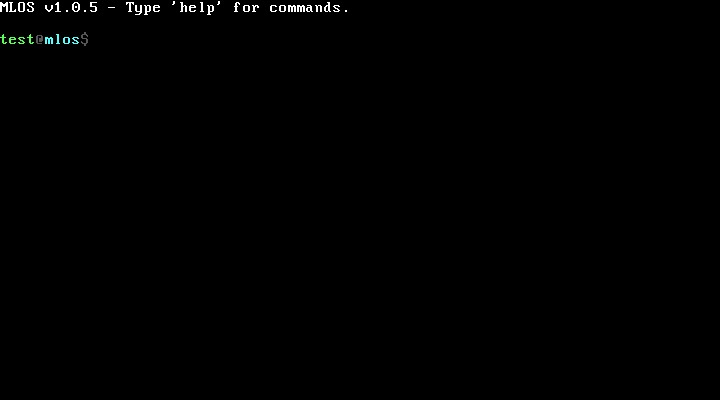

# MLOS

简体中文 | [English](README.en.md)

**MLOS**（Minimal Light Operating System，极轻量操作系统）是一个使用 Rust 从零编写的 64 位操作系统，以约 5 MB 的可引导 ISO 镜像交付。它基于 GRUB 2（Multiboot2）在 BIOS 模式下启动，内置交互式 Shell、性能监视器、文件浏览器、安装向导与密码登录、硬盘数据持久化、小游戏和实用工具。

- **开发者**：MEME-LMXDG
- **语言**：Rust（`no_std` 裸机内核，x86_64）
- **仓库**：<https://github.com/lmxdg/MLOS>
- **下载页**：<https://github.com/lmxdg/MLOS/releases>

---

## 系统特性

### 核心系统
- 纯 Rust 编写的 64 位裸机内核（`no_std`、`no_main`）
- Multiboot2 引导头 + GRUB 2，32 位保护模式 → 64 位长模式切换
- VGA 文本模式显示（80×25，CP437），硬件光标
- PS/2 键盘驱动，完整美式布局（Shift、退格、回车）
- 通过 Multiboot2 内存映射检测可用内存

### 安装与登录（v1.0.6 新流程）
首次启动进入 **5 步安装向导**：

1. **选择语言**：English 或 中文（预览版）
2. **硬盘检测**：确认 ATA 硬盘可用
3. **创建账户**：设置用户名与密码（FNV-1a 哈希写入硬盘，绝不存明文）
4. **安装系统**：写入引导程序与内核，用**旋转动画**反馈进度
5. **完成**：直接进入登录界面

之后每次启动都需要登录验证；`setup` 命令可重新运行向导，`exit` 可注销回到登录界面。

### 中文（预览版）支持（v1.0.6 新增）
- 通过 `lang zh` 命令或在安装向导第一步选择中文，即可切换界面语言；偏好写入硬盘，下次开机自动生效
- 实现原理：VGA 字符发生器字模重编程，把汉字 16×16 点阵拆成左右两个 8×16 字形，占用 ASCII 保留区之外的字符码；ASCII 区保持不变
- 字库由 `tools/gen_zhfont.py` 从 Noto Sans CJK SC 自动生成，收录系统文案中出现的汉字（约 350 字）
- 语言切换框架、双语文案、字库与渲染管线均为完整实现：英文界面在任何环境正常；中文界面在支持字模重编程的 VGA 上显示汉字点阵
- **预览版限制**：
  - 字形槽只有 64 个，同屏不同汉字过多时较早装入的字模会被覆盖；字库外的汉字显示为 `?`
  - 部分虚拟 VGA（如 QEMU 的 std / Cirrus 模拟）会锁定字符码 `0x80-0xFF` 使用 ROM 字体，导致该区间无法加载自定义字模——在这些环境下中文可能显示为 CP437 字符。**真机 VGA 与标准 VGA 实现不受此限制**。若在虚拟机中遇到此情况，请用 `lang en` 切回英文
  - 这是实验性功能，欢迎反馈

### 硬盘持久化
- ATA PIO（LBA28）驱动，操作主硬盘
- 用户配置写入 LBA 1 扇区（魔数 + 校验和）
- MiniFS 文件存储区，可在硬盘中保存用户文件

### 硬盘自引导安装（免 ISO 开机）
- 安装向导完成时自动把 **完整系统写入硬盘**：MBR 引导扇区、自研 Stage2 引导程序（含 Multiboot2 信息构建）、内核镜像
- 安装后可直接从硬盘启动 MLOS，**不再需要 ISO**（`bootinstall` 命令可随时重装/修复）
- 自研双阶段引导：MBR（EDD 读取）→ Stage2（加载内核、e820 内存图、进入保护模式并跳转）

### USB 兼容（USB 1.0 - 3.2）
- PCI 总线枚举，自动识别全部 USB 主控类型：
  **UHCI / OHCI**（USB 1.0 / 1.1）、**EHCI**（USB 2.0）、**xHCI**（USB 3.0 / 3.1 / 3.2）
- `usb` 命令列出检测到的控制器（类型、PCI 位置、速率等级）与兼容性说明

### 自适应分辨率
- 启动时自动检测显示参数：固件 framebuffer（Multiboot2）+ VGA CRTC 寄存器探测实际控制台行列
- `resolution` 命令显示适配器能力与当前控制台模式，GUI 布局跟随检测到的显示尺寸

### 性能监视器（`perf`）
- **CPU**：通过 CPUID 读取厂商信息，TSC 频率经 PIT 校准，实时周期计数
- **内存**：可用总量、内核占用、剩余内存与使用率
- **硬盘**：通过 ATA IDENTIFY 获取容量、MLOS 已用扇区、剩余空间

### 类 Linux 命令行（v1.0.6 扩充）
- Shell 提示符采用 `user@mlos:~$` 风格，支持逻辑工作目录（`pwd` / `cd` / `cd ..` / `cd ~`）
- 命令风格向 Linux 靠拢：`ls -l`、`cat -n`、`uname -a`、`grep`、`history`、`man`、`whoami`、`who`、`hostname`、`uptime`、`free`、`df`、`ps`、`top`、`mkdir` / `touch`、`exit` / `logout`
- `help` 按分类列出全部命令；`man <命令>` 提供简要手册；未知命令给出清晰提示
- 支持 `exit` 注销并回到登录界面，无需重启

### 文件浏览器（`ls` / `cat` / `write` / `rm`）
- MiniFS：建立在原始硬盘扇区上的简易文件存储（目录扇区位于 LBA 4，共 12 个文件槽位 × 4 KB）
- 在 Shell 中直接创建、列出、查看和删除文本文件

### 在线更新检测（`update`）
- 对比本地版本与 GitHub 最新 Release 版本号
- MLOS 内核本身不带网络栈；配套主机脚本 `tools/check_update.sh` 从 GitHub 拉取最新版本号写入硬盘 LBA 3 扇区，随后 `update` 命令会报告：*已是最新*、*发现新版本*（附下载地址）或*未获取到信息*

### 桌面 GUI（`gui`，v1.0.6 重做）
- Linux 风格文本桌面：顶部面板 + 桌面图标 + 2×2 平铺窗口 + 底部任务栏
- **支持 PS/2 鼠标点击**：点击 `[Apps]` / `[Start]` 打开菜单、点击图标启动程序、点击标题栏聚焦窗口、点击 `[X]` 关闭窗口、点击文件列表打开文件查看器
- 键盘仍可操作：`M` 打开菜单，方向键选择，`Enter` 打开，`Tab` 切换窗口，`Esc` 关闭窗口 / 退出
- 去掉了旧版"实验性功能"确认步骤，输入 `gui` 或 `gui on` 直接启动；桌面内可点击语言按钮或菜单项切换中英文

### 小游戏
- 数字炸弹、猜数字、石头剪刀布

### 实用工具
- 计算器、进制转换、素数判断、FNV-1a 文本哈希、随机数、ASCII 表

---

## 系统截图

| | |
|---|---|
| Shell 与横幅 |  |
| 帮助信息 |  |
| 关于系统 |  |
| 性能监视器（`perf`） |  |
| 文件列表（`ls`） |  |
| 文件内容（`cat`） |  |
| 删除文件（`rm`） |  |
| 硬盘状态（`disk`） |  |
| 更新检测（`update`） |  |
| 游戏菜单 |  |
| GUI 启动警告（v1.0.5 历史截图，v1.0.6 已取消） |  |
| GUI 桌面（v1.0.5 历史截图，v1.0.6 支持鼠标） |  |
| GUI 开始菜单 |  |
| GUI 性能监视器 |  |
| GUI 文件查看 |  |
| 安装向导（v1.0.5 历史截图，v1.0.6 已重做为 5 步） |  |
| 系统写入硬盘（免 ISO 引导） |  |
| 硬盘直接启动 → 登录 |  |
| 硬盘直接启动 → Shell |  |

---

## 命令列表

```
help  man     clear   echo    history exit    logout  reboot  halt
pwd   cd      ls      cat     write   touch   rm      grep
version  uname  about  whoami  who    id      hostname  date    uptime
mem   free    df      ps      top     perf    disk    usb     resolution
lang  color   banner  setup   bootinstall    update  gui
games bomb    guess   rps     tools   calc    base    prime   hash    rand    ascii
```

完整列表见 `help` 命令，命令用法见 `man <命令>`。

---

## 在虚拟机中运行 MLOS

> **重要**：MLOS 使用 GRUB `i386-pc` 引导，虚拟机必须使用 **BIOS（传统）启动**。**请勿**在虚拟机设置中启用 UEFI/EFI。将 `MLOS.iso` 挂载为 CD-ROM，同时挂载一块虚拟硬盘用于数据持久化，内存至少 128 MB。

### 1. QEMU（Linux / macOS / Windows）

```bash
# 创建 16 MB 持久化硬盘镜像
qemu-img create -f raw mlos-disk.img 16M

# 启动（BIOS 模式，光盘优先启动）
qemu-system-x86_64 -cdrom MLOS.iso -m 128M -boot d -net none \
  -drive file=mlos-disk.img,format=raw,if=ide,index=0,media=disk
```

可选参数：`-vga std`（标准 VGA 显卡）、`-display gtk` / `-display sdl`（显示窗口，默认即有）。

### 2. VirtualBox

1. **新建** → 名称 `MLOS`，类型选 `Other`，版本选 `Other/Unknown`（或 DOS）
2. 内存：**128 MB** 或以上
3. 虚拟硬盘：**现在创建虚拟硬盘** → VHD 或 VDI，容量 ≥ 16 MB，挂载为 **IDE 主通道主盘**（Primary Master）
4. 虚拟机 **设置 → 存储**：把 `MLOS.iso` 挂载到 **IDE 次通道主盘**（光驱）
5. 设置 → **系统 → 启动顺序**：把 **光驱** 放到第一位
6. 设置 → **系统 → 主板**：**不要勾选「启用 EFI」**
7. 启动虚拟机。首次启动进入安装向导；完成后在「存储」中移除 ISO，之后即可从硬盘启动。

### 3. VMware（Workstation Pro / Player / Fusion）

1. **创建新的虚拟机** → 选择 **稍后安装操作系统**
2. 客户机操作系统：**其他** → 版本：**其他**（默认固件为 BIOS）
3. 内存：128 MB 或以上
4. 磁盘：新建虚拟磁盘（建议 IDE 控制器），容量 ≥ 16 MB
5. **编辑虚拟机设置 → CD/DVD (IDE)**：选择 *使用 ISO 映像文件* → 选中 `MLOS.iso`，勾选 **启动时连接**
6. 固件保持 **BIOS**（选项 → 高级 → 固件类型选 BIOS，不要选 EFI）
7. 开机。首次安装完成后，从 CD/DVD 设备中弹出 ISO，改为从硬盘启动。

### 4. Bochs

`bochsrc` 配置：

```
megs: 128
boot: cdrom
ata0-master: type=disk, path="mlos-disk.img", mode=flat, cylinders=32, heads=16, spt=63
ata0-slave: type=cdrom, path="MLOS.iso", status=inserted
```

运行 `bochs -q`（先用 `bximage -hd -size=16 -imgmode=flat mlos-disk.img` 创建硬盘镜像）。

### 5. Hyper-V（Windows）

1. Hyper-V 管理器 → **新建 → 虚拟机**
2. 代数：选 **第一代**（第一代为 BIOS 固件；第二代仅支持 UEFI，无法启动）
3. 内存：启动内存 128 MB，如遇问题请关闭动态内存
4. 网络：断开（无需网络）
5. 虚拟硬盘：创建一个小型 VHD（≥ 16 MB），挂载到 IDE 控制器
6. 安装选项：*从可启动的 CD/DVD 安装操作系统* → 映像文件 → 选择 `MLOS.iso`
7. 安装完成后，从虚拟机的 DVD 驱动器中移除 ISO，改为从虚拟硬盘启动。

### 首次启动流程（所有虚拟机通用）

1. 从 ISO 启动 → 安装向导 → 设置用户名与密码
2. 配置写入虚拟硬盘，重启后依然保留
3. 登录后体验 `perf`、`write`、`ls`、`cat`、`games`、`update`

---

## 从源码构建

环境要求：Rust（推荐 1.93.0）及 `rust-src` 组件、`grub-mkrescue`、`xorriso`、`mtools`、QEMU。

```bash
# 构建内核并打包 ISO
make iso          # 生成 MLOS.iso
```

### 更新检测

```bash
# 在宿主机上执行：把 GitHub 最新 Release 版本号写入硬盘镜像
./tools/check_update.sh mlos-disk.img
# 然后启动 MLOS，登录后运行：update
```

---

## 项目结构

```
MLOS/
├── src/
│   ├── main.rs          # 内核入口、横幅、内存映射解析
│   ├── boot.rs          # 32 位 → 64 位长模式切换
│   ├── vga.rs           # VGA 文本模式终端 + 双语打印宏
│   ├── zhfont.rs        # 中文预览版：VGA 字模重编程与槽位管理
│   ├── zhfont_data.rs   # 自动生成的汉字点阵字库（gen_zhfont.py）
│   ├── keyboard.rs      # PS/2 键盘驱动
│   ├── mouse.rs         # PS/2 鼠标驱动（点击/坐标映射）
│   ├── input.rs         # 行编辑辅助
│   ├── io.rs            # 端口 I/O（inb/outb/rdtsc 等）
│   ├── ata.rs           # ATA PIO 硬盘驱动（读/写/识别）
│   ├── storage.rs       # 用户配置持久化（LBA 1）
│   ├── fs.rs            # MiniFS 文件存储（LBA 4 起）
│   ├── perf.rs          # 性能监视器（CPUID/TSC/PIT）
│   ├── update.rs        # 版本对比 + 远端版本信息（LBA 3）
│   ├── setup.rs         # 安装向导 + 登录
│   ├── shell.rs         # 交互式 Shell
│   ├── games.rs         # 小游戏
│   ├── tools.rs         # 实用工具
│   └── rng.rs           # xorshift64* 随机数
├── tools/
│   ├── check_update.sh  # 主机侧更新拉取脚本
│   └── gen_zhfont.py    # 重新生成中文点阵字库
├── screenshots/         # 系统截图（英文界面）
├── grub.cfg             # GRUB 菜单
├── linker.ld            # 内核链接脚本
├── x86_64-os.json       # 自定义 Rust target
└── Makefile             # 构建 / ISO / 运行目标
```

---

## 硬盘布局（系统扇区与 MiniFS）

| LBA | 用途 |
|-----|------|
| 1   | 用户配置（魔数 `MLOS`、用户名、FNV-1a 密码哈希、语言偏好、校验和） |
| 3   | 远端版本信息（魔数 `UPDT`，由 `tools/check_update.sh` 写入） |
| 4   | MiniFS 目录扇区（魔数 `MFSD`，12 个条目） |
| 5+  | MiniFS 文件数据，每槽位 8 个扇区（4 KB） |
| 2048 | MLOS 磁盘引导 Stage2（16 KB，由安装程序写入） |
| 4096 | 内核镜像头（魔数 `MLBX`、扇区数、入口偏移） |
| 4097+ | 内核扁平镜像（安装程序从运行中的内核转储） |

## 许可证

MIT
