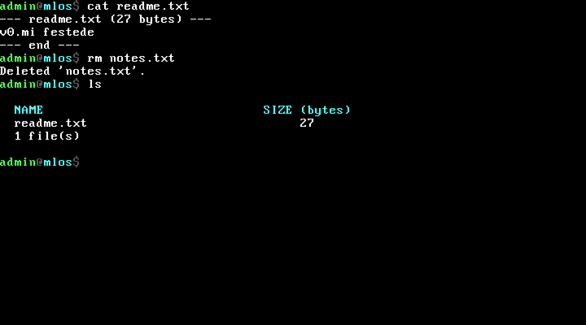

# MLOS

**MLOS** (Minimal Light Operating System) is a small 64-bit operating system written from scratch in Rust. It boots from a GRUB 2 (Multiboot2) ISO on BIOS systems, ships an interactive shell, games, tools, a setup wizard with password login, hard-disk persistence, a performance monitor and a mini file browser — all in a ~5 MB bootable ISO.

- **Developer**: MEME-LMXDG
- **Version**: 1.0.2
- **Language**: Rust (`no_std` bare-metal kernel, x86_64)
- **Repository**: <https://github.com/lmxdg/MLOS>
- **Releases**: <https://github.com/lmxdg/MLOS/releases>

---

## Features

### Core system
- 64-bit bare-metal kernel written in pure Rust (`no_std`, `no_main`)
- Multiboot2 boot header + GRUB 2, 32-bit protected mode → 64-bit long mode trampoline
- VGA text mode display (80×25, CP437) with hardware cursor
- PS/2 keyboard driver with full US layout (shift, backspace, enter)
- Usable-memory detection from the Multiboot2 memory map

### Installation & login
- First-boot setup wizard: choose a username and password
- Passwords stored as FNV-1a hashes on disk (never in plain text)
- Login screen on every subsequent boot

### Hard-disk persistence
- ATA PIO (LBA28) driver for the Primary Master disk
- User configuration written to disk sector LBA 1 with magic + checksum
- MiniFS file store (see below) for user files

### Performance monitor (`perf`)
- **CPU**: vendor string via CPUID, TSC frequency calibrated against the PIT, live TSC cycle count
- **Memory**: total usable, kernel image footprint, estimated free memory and usage %
- **Disk**: capacity from ATA IDENTIFY, sectors used by MLOS, free space

### File browser (`ls` / `cat` / `write` / `rm`)
- MiniFS: a simple file store laid out on raw disk sectors (directory sector at LBA 4, 12 file slots × 4 KB each)
- Create, list, read and delete text files directly from the shell

### Online update check (`update`)
- Compares the local version with the latest GitHub release
- MLOS has no network stack by design; the bundled host script `tools/check_update.sh` fetches the newest release tag from GitHub and writes it into disk sector LBA 3, then `update` reports: *up to date*, *new version available* (+ download URL), or *no info*

### Games
- Number Bomb, Guess Number, Rock-Paper-Scissors

### Tools
- Calculator, base conversion, prime check, FNV-1a text hash, random numbers, ASCII table

---

## System Screenshots

| | |
|---|---|
| Shell & banner |  |
| Help |  |
| About |  |
| Performance monitor (`perf`) |  |
| File listing (`ls`) |  |
| File content (`cat`) |  |
| File delete (`rm`) |  |
| Disk status (`disk`) |  |
| Update check (`update`) |  |
| Games menu |  |

---

## Commands

```
help    clear   echo    version about   whoami  uname   date    mem
perf    ls      cat     write   rm      disk    update  color   banner
setup   reboot  halt    games   bomb    guess   rps     tools   calc
base    prime   hash    rand    ascii
```

---

## Build & Run

Requirements: Rust (1.93.0 recommended) with `rust-src`, `grub-mkrescue`, `xorriso`, `mtools`, QEMU.

```bash
# Build the kernel and ISO
make iso          # produces MLOS.iso

# Run in QEMU (BIOS boot, with a persistent 16 MB disk image)
qemu-img create -f raw mlos-disk.img 16M
qemu-system-x86_64 -cdrom MLOS.iso -m 128M -boot d -net none \
  -drive file=mlos-disk.img,format=raw,if=ide,index=0,media=disk
```

The first boot starts the setup wizard; after reboot you log in with your credentials.

> **Note**: the ISO uses GRUB `i386-pc`, so it boots in BIOS (legacy) mode, not pure UEFI.

### Update check

```bash
# On the host: fetch the latest GitHub release tag into the disk image
./tools/check_update.sh mlos-disk.img
# Then boot MLOS and run:  update
```

---

## Project Layout

```
MLOS/
├── src/
│   ├── main.rs          # kernel entry, banner, memory-map parsing
│   ├── boot.rs          # 32-bit → 64-bit long mode trampoline
│   ├── vga.rs           # VGA text-mode terminal + print macros
│   ├── keyboard.rs      # PS/2 keyboard driver
│   ├── input.rs         # line editing helpers
│   ├── io.rs            # port I/O (inb/outb/rdtsc...)
│   ├── ata.rs           # ATA PIO disk driver (read/write/identify)
│   ├── storage.rs       # user config persistence (LBA 1)
│   ├── fs.rs            # MiniFS file store (LBA 4+)
│   ├── perf.rs          # performance monitor (CPUID/TSC/PIT)
│   ├── update.rs        # version compare + remote info (LBA 3)
│   ├── setup.rs         # setup wizard + login
│   ├── shell.rs         # interactive shell
│   ├── games.rs         # games
│   ├── tools.rs         # tools
│   └── rng.rs           # xorshift64* random numbers
├── tools/
│   └── check_update.sh  # host-side update fetcher
├── screenshots/         # system screenshots (English UI)
├── grub.cfg             # GRUB menu
├── linker.ld            # kernel linker script
├── x86_64-os.json       # custom Rust target
└── Makefile             # build / iso / run targets
```

---

## Disk Layout (MiniFS & system sectors)

| LBA | Purpose |
|-----|---------|
| 1   | User configuration (magic `MLOS`, username, FNV-1a password hash, checksum) |
| 3   | Remote version info (magic `UPDT`, written by `tools/check_update.sh`) |
| 4   | MiniFS directory (magic `MFSD`, 12 entries) |
| 5+  | MiniFS file data, 8 sectors (4 KB) per slot |

## License

MIT
